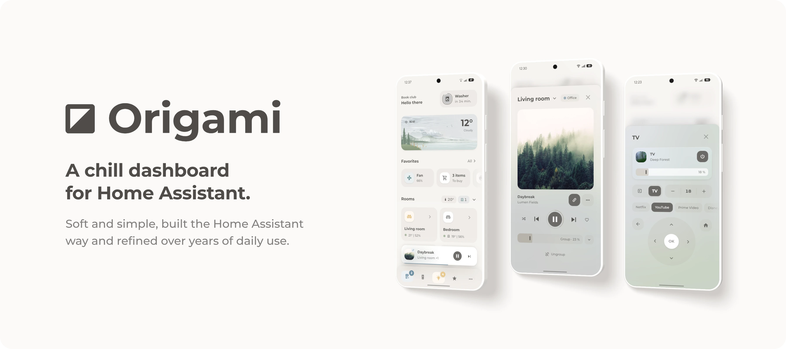

# Changelog

## Next release

- The navigation bar no longer sits under the phone's navigation buttons, such as Android's three buttons.

## 3.0 · The Final Fold

<picture>
  <source media="(prefers-color-scheme: dark)" srcset="https://raw.githubusercontent.com/hazymorning/origami/main/images/v3/hero-dark.webp">
  
</picture>

Origami 3.0 finishes what 2.0 started. Paper Buttons Row is gone, and most of the dashboard is plain Bubble Card with the Origami modules on top. Every part has its own folder with its files and a short README, so a home takes only the parts it wants, without a package or one large dashboard file.

New are the pop-ups for the lights, music, favorites, the server and the vacuum, small pop-ups that open right at their key, and three weather cards. It took a long time, and now it finally feels somewhat finished.

### Upgrading

Updating Origami in HACS only updates the theme. The Bubble Card modules were copied in by hand, so their new versions are pasted in by hand too, and a few cards need a small change, as the steps below say. After that, the 2.0 dashboard keeps working, and the new parts can take the place of the old cards one at a time. Each part is set up with the home's own entities, so moving everything takes some time, but nothing has to move at once.

1. Update Bubble Card to 3.4 or later, and Navbar Card to 1.8.0 or later if the dashboard uses it.
2. Update Origami in HACS and run `frontend.reload_themes`. The 2.0 cards keep their look, apart from the new shadows and a slightly lighter page in light mode. A copy of the theme under another name keeps its old shadows until it gets the new shadow tokens from the new theme: `shadow-edge`, `chip-shadow`, `shadow-elevated`, `shadow-sheet` and `tile-chip-background` in each mode, and `tile-chip-shadow: 'var(--chip-shadow)'` at the top.
3. Update all modules together, because the new ones need the new Base. In the editor of any Bubble card, open **Modules**, then **My Modules**, and paste each module's new version from [`bubble_card/modules`](https://github.com/hazymorning/origami/tree/main/bubble_card/modules) over its old one. Delete Light and Speaker Select there, because 3.0 has no such modules. For modules in `/config/bubble_card/modules`, copy the folder again and delete `origami_light.yaml` and `origami_speaker.yaml`.
4. Take `origami_light` and `origami_speaker` out of the cards that use them. Light cards need `state_content` with `state` and `brightness`, and fan cards `state_content: percentage`, because no module writes their state line anymore.

   ```yaml
   state_content:
     - state
     - brightness
   ```

<a name="moving-to-the-new-parts"></a>
<details>
<summary><b>Moving to the new parts</b></summary>

<br>

Each part is set up from its folder, as its README says, and takes the place of these 2.0 cards. The pop-ups for the lights, music, favorites, the server and the vacuum are new.

| 2.0 | 3.0 |
| --- | --- |
| Greeting and notifications | [Greeting and notifications](https://github.com/hazymorning/origami/tree/main/dashboard/greeting) |
| Menu with the server card | [Menu](https://github.com/hazymorning/origami/tree/main/dashboard/menu) |
| Weather | [Weather](https://github.com/hazymorning/origami/tree/main/dashboard/weather) |
| Favorites | [Favorites](https://github.com/hazymorning/origami/tree/main/dashboard/favorites) |
| Room cards | [Rooms](https://github.com/hazymorning/origami/tree/main/dashboard/rooms) |
| Climate table | [Climate table](https://github.com/hazymorning/origami/tree/main/dashboard/climate-table) |
| Navigation bar | [Navigation bar](https://github.com/hazymorning/origami/tree/main/dashboard/navigation-bar) |
| Living room pop-up | [Room](https://github.com/hazymorning/origami/tree/main/dashboard/room) |
| TV pop-up | [TV](https://github.com/hazymorning/origami/tree/main/dashboard/tv) |
| Fan pop-up | [Fan](https://github.com/hazymorning/origami/tree/main/dashboard/fan) |
| Speaker rows with Speaker Select | [Music](https://github.com/hazymorning/origami/tree/main/dashboard/music) |

- Four entities of the 2.0 package already have the IDs that the parts use: `input_boolean.all_rooms` for Rooms, `input_select.selected_speaker` for Music, and `script.thermostat_step` and `script.volume` for Room and TV. The parts use them as they are, so they aren't created again. A second one with the same name would get `_2` at the end of its entity ID.
- Once no card reads the package's other helpers and sensors, `/config/packages/origami.yaml` can go. After a restart, create those four again as the parts' READMEs describe.
- Paper Buttons Row can go once no card uses it.
- The new TV remote sends an arrow's command once while it's held, because Bubble Card can't repeat an action.

</details>

<a name="changes-on-2-0-cards"></a>
<details>
<summary><b>Changes on 2.0 cards</b></summary>

<br>

With the new modules, some 2.0 cards look a little different. This is what changes, and how a card that stays keeps its old look.

- **Cards with only Base.** They show a state line only with `state_content`, such as `state_content: state`. A separator or sub-buttons card with only Base looks like a plain Bubble card, because Header, Tiles and Button draw those cards now.
- **Words.** The cards show Home Assistant's own words, so some change, such as Unavailable instead of Error. Base's `words` option keeps a word on a card, such as `idle: Auto`.
- **Speaker icons.** Media shows the card's own icon, or Home Assistant's icon for the state. The old icons come back with `icons` and `'off': mdi:speaker-off`, `playing: mdi:speaker-pause`, `bluetooth: mdi:speaker-bluetooth` and `tv: mdi:television-speaker`. A tap on the icon opens the more-info dialog, unless the card's `tap_action` has `action: none`.
- **Speaker names.** They're no longer shortened. The title shows the card's `name` or the speaker's name, and a TV input its own name, such as Optical In, which `words` can rename.
- **Speaker groups and covers.** They come from `group_members` and the speaker's own picture instead of the LinkPlay sensors. For a speaker that reports neither, `leader` and `art` take templates that return the leader's entity ID and the cover's address. A Music Assistant player that belongs to a speaker goes into `players`.
- **Thermostats.** Cards without their own icon show Home Assistant's icons for heating and the other actions. For a radiator's old icons, add `icons` under `origami_climate` with `heating: mdi:radiator`, `preheating: mdi:radiator` and `'off': mdi:radiator-off`.
- **Headers.** `color` colors only the icon, so text that should keep the color needs `name_color` with the same value. The icons are a step smaller, and `icon_size: var(--dot-size)` brings back the old size on each header without its own `icon_size`.
- **Pop-ups.** A pop-up with `performance_mode: performance` no longer blurs the page behind it, and one with its own `backdrop_blur` blurs it by that amount.
- **Tiles.** Pictures fill the icon, and `image_size: 230%` zooms in as before. A tile takes a state color only while its entity is on, so a tile with a number or a temperature needs a `color` under its `origami_tiles` key to keep its color.

</details>

<a name="every-change"></a>
<details>
<summary><b>Every change</b></summary>

<br>

#### New

#### All modules

- The modules work for every home and language. They show Home Assistant's own words for states and attributes, as asked in discussion #26. Base keeps shorter words where Home Assistant's are too long for a card, and its new `words` option changes any word on a card, such as `Ein: An`, also in the state line that Bubble Card writes.
- The modules follow Home Assistant's rules for when an entity counts as on and which color it gets.
- Parts are placed by start and end instead of left and right, so cards are mirrored in languages that read from right to left.
- A sub-button whose tap sets a value, such as a fan speed, a preset, a source, a brightness or a target temperature, is filled while its entity has that value. A source button also matches a TV's `app_name` or `app_id`.
- Sub-buttons have four new keys: `on` fills a sub-button, `disabled` shows a control that cannot work, `dot` marks a control that is on with a small dot, and `hidden` hides a sub-button from a template that can read any entity.
- Templates in values have `num()`, `format()`, `word()`, `ago()` and `name()`. A `${ }` expression that returns `unavailable` or `unknown` counts as empty, and `minutesUntil()` also reads timers and dates.
- The keys of a map in a value match in any case, so `On` and `on` are the same key.
- The state line under a card's name and the state on a tile use the medium weight instead of bold.
- A card with `bottom_layout: rows` and `rows: auto` grows with its rows.
- Options that moved or were renamed in this release still work: `compact`, `animate`, `solid_controls`, `art_entity`, `app_entity` and `subtitle_style`.
- Base and Media read `state_content` before the older `show_state` and `show_attribute` keys, as Bubble Card 3.4 does, so a card keeps its look after Bubble Card's editor rewrites those keys, and `state_content: []` hides Media's line.
- The card editor shows Tiles' list options only for a list, and Popup's cover mix and blur only with `art`.
- The modules do less work each time Bubble Card styles a card, which happens about seven times while a pop-up opens. They measure long names once per frame, write a dropdown's items only when their entity changes, and give the slider rules only to cards with a slider. Base compiles each template once for the whole page and remembers what it reads from a card's sub-buttons and from each state, so a pop-up that opens again does a third of the work, and Tiles and Button write only the rules that a card's rows and buttons use. The cards look and work as before. The modules need Base 13.1 and Bubble Card 3.4 or later.

#### Base

- Base is the shared core of all modules. Bubble Card runs it on every card with an Origami module, and the module reference lists its helpers for new modules.
- `vertical` places the name under the icon, as on the room cards.
- `large` makes the name larger, as on a card at the top of a pop-up.
- `animate` fades a card in. Button cards, media cards and pop-ups also glide to their new height when their content changes. It replaces Button's option of the same name.
- `padding`, `sub_button_height` and `sub_button_text_size` set a card's padding and the size of its sub-buttons, sliders and Button rows. Bubble Card's `custom_height` on a single sub-button wins over them.
- All dividing lines share one width and the theme's line color.
- A compact card's icon has no background, as in a slim list.
- On a compact card, a slider sub-button with `always_visible: true` takes the place of the pill switch.
- In a gray tray on a card, a key with a background and a filled key cast the chip shadow, and in the tray on a tile, the keys are flat. A key that turns on keeps the shadow of its place, also a dropdown.
- Controls at the end of a row end at the card's padding, and a tray with three keys has the same width on every card, so trays and side sliders line up.
- A dropdown whose options are entity IDs, such as a speaker picker, shows the chosen entity's name in a chip, with a small icon before it. Its menu lists the entities' names with an icon for each state, it is as wide as its longest option, and it has the spacing of a mini pop-up. In a card's own row, the dropdown is as tall as the name and the state line, and its text is as large as the name.
- A new cover keeps the last one in place until it has loaded, so switching speakers never leaves a cover or a pop-up's background empty.
- `frameless` removes a card's background, shadow and padding, such as for a large cover in a pop-up. Its content reaches the edges, with the same gap between all its rows, and its icon, keys and sliders have the subtle fill of a Button row's tiles.
- A sub-button's `label` key puts a small line under its text, such as CPU under 12 %, so a card can show values with labels beside its name.
- On a key with an icon and a name, such as Pause, the icon is a step smaller and stands 8 px from the name.
- `join` lets cards in a vertical stack share one background, as the rows of a list, such as the lamps of a pop-up. The list keeps the card's padding at its ends, and its rows' controls are 8 px apart. A compact row's slider is 28 px tall, as its switch and Slider's rows are, so two rows' sliders are 12 px apart.
- `hidden` hides a whole card while its template is true, such as a list of lamps while its header is closed. The card takes no space in a stack, a section or a mini pop-up, as a conditional card's, and it changes at the same moment as the cards around it.
- Module authors get four new helpers: `shows()`, `unframe()`, `backdrop()` and `pending()`, which Button and Tiles share for a button or a row that waits after a tap.
- All cards share one number and date formatter, so they render with less work.
- Sliders are never colored, also not for a light, because the state color belongs to the icon. A slider's fill is the theme's `fill-loud`, a stronger step of its track's tint, so it keeps its contrast on a card, a tile or a cover behind a pop-up.

#### Media

- Groups come from `group_members` and covers from the speaker's own picture, so Media works with any integration that reports them. The new `players`, `leader`, `art`, `inputs` and `icons` options cover other setups.
- A player in `players`, such as Music Assistant, gives the music while it plays or is paused, before the speaker itself. Such a player reports a new song at once, while a polled speaker reports it seconds later.
- `layout: tv` shows what is cast, the running app or the source.
- Source names such as HDMI 1 or Line In 2 count as inputs. Short names such as TV, CD and FM count only on their own.
- Media writes the name and state lines through Bubble Card's own lines, and a card's `name` can be a template.
- New options: `keep_name`, `state`, `badge` and `icon_color`. `players` accepts a template, also in each entry of a list.
- A play row for music pop-ups: a bottom sub-button with `css_class: play` is a large play key with a progress ring, between shuffle, previous, next and repeat. A sub-button with `css_class: members` shows how many speakers play in the group.
- The ring skips a player that has lost track of the music, such as a Music Assistant player whose position stands still, and follows the speaker itself.
- A disabled play key rests in a quiet fill, so the play row can stay in place while nothing plays.
- The play key is the largest control after the cover. Beside a large cover above the name, it has a 64 px fill with a 40 px icon inside its ring at 80 px, and beside a smaller cover it is one step smaller. Its ring has the tints of a slider: the track of `fill-strong` and the arc of `fill-loud`.
- `cover` shows the cover in the icon, above the name as a large square, alone as that square with nothing else on the card, or as the card's background. A list combines `background` with `icon` or `above`, and a map or a template can change the place with the state. `cover_mix` and `cover_blur` set how strongly the background cover shows and blur it.

#### Speaker Select

- The Speaker Select module is gone. The music pop-up picks a speaker with a dropdown and groups speakers in a list, and Media marks a group with `badge`, so Speaker Select had nothing left to do.

#### Climate

- The target shows its decimals, and thermostats with a low and a high target show the range.
- Thermostats without `hvac_action` get a color in every mode except off.
- `icons` chooses the icons. Home Assistant's icons are the default.

#### Fan

- The Fan module works with any number of speeds.
- The icon spins backwards while the fan runs in reverse. It stands still when the device asks for reduced motion.

#### Header

- Header and Popup share their value keys: `name`, `icon`, `color`, `name_color` and `background`.
- New options: `size: large`, `title_action`, `value_size`, `scroll` and `value_position: above`, which puts the values in a small line above the title.
- The `switch` value style joins the values into one small switch.
- A chosen value on a switch or a chip has the active fill, as every active control. On a switch, it also casts the chip shadow.
- Header writes the title itself, so a title with a `${ }` template shows at once.

#### Popup

- `art` shows a blurred cover behind the content. `cover_mix` and `cover_blur` work as in Media. With a media player's entity ID, it shows the same cover as a Media card for that player.
- `gap` sets the space between the cards of a vertical stack.
- Popup writes the title itself, so a title with a `${ }` template shows at once, such as the view that a helper chooses.
- `value_position: beside` puts the values beside the title.
- Every pop-up blurs the page behind it by 10 px, as with `backdrop_blur: 10`, unless it sets its own `backdrop_blur`. The backdrop is blurred through Bubble Card's own `backdrop_blur` variable, which older Safari also reads, and as with `backdrop_blur`, the pop-up's surface then has no blur of its own, so the phone draws one blur instead of two. An empty `backdrop_blur`, as Bubble Card's editor leaves it, counts as not set.
- Pop-ups keep Bubble Card's header layout when the header has a button, a switch or a slider.
- A mini pop-up has the card background, as a menu does, so it stands out from the dimmed pop-up behind it.
- A pop-up at the bottom of the screen casts the theme's new `shadow-sheet`, soft layers that rise from its top edge, and a centered one `shadow-elevated`, as a mini pop-up does, whatever `shadow_opacity` says, unless it is `0`. The shadow slides in and out with the pop-up, also without `shadow_opacity`. The buttons of a frameless mini pop-up lie on the dim as on a gray fill, so they cast the chip shadow, and it shows whole.
- With `scrolling_effect: false`, a long title ends with an ellipsis.
- A dropdown in the header, such as a speaker picker, shows the chosen entity's name as large as the title, with a chevron about as wide as the name's small letters. While the title is empty, it stands in the title's place and the other values stand at the end, before the close button.
- `mini_popups` adds mini pop-ups: small pop-ups with cards of their own that a key in the pop-up opens with `fire-dom-event`. One opens above its key where it fits, or else on the side with more room. It grows out of its key over the dimmed pop-up as Home Assistant's menus do, and shrinks back into it when it closes, so it can stand in for a view that a helper switches. The pop-up draws its mini pop-ups ahead, so a slow phone shows the whole motion too, and the edge next to the key stays in place while the mini pop-up's cards change. A mini pop-up with its own `width` lines up with its key, `width: fit-content` makes it as wide as its widest card, such as a list of buttons, and cards taller than its `max_height` scroll inside it and fade out at its edges. With `frameless: true`, its cards stand on the dim like the buttons of a sheet. The dim has the color and the blur of Bubble Card's backdrop, and beside Home Assistant's sidebar it covers what the backdrop covers.

#### Button

- New options: `segmented`, `scroll`, `chips`, `labels: below`, `field_size`, `outline`, `start`, `pending`, `color` and `label_size`.
- `active` also matches the entity that a button's tap targets.
- Each button can have its own `name`, `icon`, `color`, `name_color`, `background` and `order` under an `origami_button` key. Its `color` is also its lamp color while it is lit.
- A lit button is tinted in its own lamp color, such as the state color of its entity, instead of always the card's.
- A button with `content_layout: icon-top` is a box like a tile, with its icon in a field above its name, 12 px around the field, 14 px above the text and 18 px below it, and the boxes in a row share one width. A box's name is bold. A lit box tints its field in its own color, as a lit tile does, and a box whose field holds a picture or colors gets a small dot before the line under its name instead and keeps its name in the text color. The field has the corners of the icon on a tile, `radius-inner`. A button's own `field` fills the field with a picture or a gradient instead of the icon, and its `label` adds a second line under the name, such as a scene's brightness. Both also work with `labels: below`.
- A button with `css_class: divider` is a short line between two buttons.
- The active segment of a bar or a small switch has the fill of an active button with `active_style: toggle`, and it casts the chip shadow.
- On a button card, a lit button has the tint of the card's lit icon. On a tile, the buttons have the card background and the chip shadow, as keys do.
- Button also works on button cards, where it styles the bottom sub-buttons.
- A scrolling row reaches past its card so its buttons scroll to the screen's edge, and only its buttons take taps there. A tap beside them reaches the card next to the row, such as a slider above it. The card is as tall as its buttons, and the row reaches past it only at its sides, so the gaps around it stay those of the page and a pop-up that scrolls ends right below its last row.

#### Light

- The Light module is gone. Sliders are never colored, and Base colors a light's icon, so Light had nothing left to do.

#### Slider

- Slider sub-buttons on a sub-buttons card are rows with a name, a track and a value. A row's track is 28 px tall, a little lower than a key, and the rows stand 12 px apart. A row's name has the size and weight of a name in a list, and its track has no grip, so the value never meets one. The name takes the first half of a row and the track the second, so a track is never wider than half the card and the tracks of several cards line up.
- A switch row fills while the switch is on.
- A standalone slider shows its name before the value with `show_name: true`, and its main sub-buttons stand after the track as keys with the track's background.
- `master: true` makes a standalone slider for a whole group, such as all lamps above a row for each lamp. It is one step taller, with its name at the start of the track, its value at the end and no grip.
- Every track, on a standalone slider and in the rows, has the subtle fill of a Button row's tiles. The value stands in the track and ends where the track's corner begins, and it uses the medium weight.

#### Tiles

- The `list` layout shows rows with an icon, a state line and a sign at the end. A chevron opens something, a switch toggles the entity, and a play sign runs a script or a scene.
- `slim` makes one-line rows for facts and settings, as tall as the one-line rows in Home Assistant's own lists, and `dividers` draws a straight line between two rows. Base's `sub_button_height` sets the height of a list's rows.
- New options: `sign` for every row, and the `state_color` and `image_size` keys for a tile.
- `sign: check` marks a chosen row with a check, such as a speaker in a group, from its entity or its own `on` key. With `pending`, a tapped row shows the sign it is about to get until its state changes, and `background: false` leaves out the list's panel inside a card or a mini pop-up, and a slim list then keeps its first and last names as far from the edge as the text around it.
- `sign: add` puts a plus in the icon's place of a row that isn't chosen, and a check once it is, such as for the speakers that can join a group.
- A list without a panel stands on the card around it, so its icons are flat fills there.
- Tiles show `state_content` and `attribute` in Home Assistant's words, show times as relative times such as 3 days ago, and dim tiles whose entity is unavailable.
- `scroll` puts a grid's tiles in one row that scrolls sideways, which takes less space on a phone.

#### Table

- The new Table module turns a sub-buttons card into a table. Each group of sub-buttons is a row, and each column has its own options in the card editor.

#### Theme

- New shadows in a dark tone of the background's hue, which follow one rule: the card background casts a shadow, and a gray fill never does. Each starts with a fine edge, the new `shadow-edge`. A card casts `card-shadow`, a mini pop-up or a menu `shadow-elevated`, a pop-up at the bottom of the screen the new `shadow-sheet`, and a control on a gray fill, such as a tile or a tray, the new `chip-shadow`. The module reference explains the rule under Depth.
- In dark mode, a control on a gray fill is one step lighter than that fill, on a tile as in a tray. Each mode sets `tile-chip-background`.
- Every corner follows one rule: the radius is the shape's height times the new `radius-ratio`, which is 0.35. The new `radius-control` token is the radius of a 40 px shape.
- Open doors are cyan, as open windows are.
- In light mode, the page is a lighter `#F6F4F1`, and gray fills such as tiles are a little lighter with a `fill-contrast` of 7 %.
- In a sections view, cards and sections stand 12 px apart, as in stacks and grids, and the page keeps 16 px above and below them.
- The theme leaves out 78 variables that nothing reads anymore or that only repeat what Home Assistant sets itself, such as the Paper Buttons Row colors and old names for fills and tints. Its comments are short, and every card looks the same.
- The theme keeps six variables that cards and modules from 2.0 read, such as `card-padding` and `scroller-mask`, because HACS updates the theme before the new modules and cards are copied. A 2.0 dashboard keeps its look in the meantime, and the six can go in 4.0.

#### Dashboard

- The room cards are Bubble cards with Base's `vertical` option.
- The TV pop-up uses Bubble cards with the Button module instead of Paper Buttons Row.
- The server card in the menu is a Bubble card.
- The climate table uses the Table module.
- The pop-ups no longer set `shadow_opacity`, because Popup gives every pop-up the theme's shadow.
- The navbar follows the rules of the Bubble cards. A line along the bottom of the now playing card shows how far the track has played.
- The favorites are tiles in one row that scrolls sideways, or in a grid for a larger screen. The README shows both.
- The lights pop-up shows how many lamps are on and since when. Each scene shows its colors in a rounded square, with the theme's corners, and its brightness under its name, and a small dot before its brightness marks the active scene. Its power key turns on the scene for the time of day while all lamps are off, and turns off every light in the home while one is on.
- The weather part has three cards: a paper diorama with a picture for each kind of weather, which the home view shows, a house whose rooms light up and show their temperature, with the day's weather, low and high on a chip, and Origami Weather's Comparison layout in calm colors that follow the weather. The pictures load from the repository, so a home needs no files of its own.
- The favorites list ends with slim rows for the calendar, the shopping list, the map and the server, each with a value at its end, such as the next event.
- In the room pop-ups, the light card's arrow to the lamps stands beside its slider, as in the lights pop-up, and the bathroom has the same light card as the living room, with its two lamps and its scenes. Only the living room's lights header opens the lights pop-up. The bathroom's opens the light group's dialog, which lists each lamp.

#### Bug fixes

- An open dropdown with an icon and no name, such as a key that picks a source, no longer shows Bubble Card's ring in the accent color.
- The icons in a dropdown's menu are as large as in a slim list, and the space around them is even.
- A slider whose entity is off shows Home Assistant's word for off, also as a standalone slider, and an unavailable one shows a dash.
- Color sliders, such as those for hue or color temperature, keep Bubble Card's colored track.
- A slider that only shows a value has no mark at the end of its fill.
- On a button card without an icon, the name keeps the card's padding.
- A row with `scroll` starts at its first button again when a button appears in front of the others.
- Header and Tiles show values exactly as written, with the space after a comma and with braces.
- On iPhones, the menu starts below the status bar.
- Base no longer replaces a card's state line with On, Off or Error, so a sensor card shows its value.
- Each pill switch shows the state of its own entity.
- In a classic pop-up, the last card scrolls fully into view. The other pop-up modes keep the space of the phone's home indicator.
- A group member's speaker card shows its leader's music, also for speakers that are not LinkPlay speakers.
- A light card of the slider type with Base shows its fill again.
- A TV that is off no longer shows the music of another player in its `players` list.
- A buffering speaker counts as playing, so `collapse` no longer shrinks the card at the start of every track. With `solid_controls`, the power button stays filled while the speaker is paused.
- An app counts as running only while its device is on.
- Each Climate readout shows the target of its own thermostat, a dash while there is no target, and a range in the right order in right-to-left languages.
- Climate buttons that set a mode or a preset are filled again while it is set.
- A tap on a Media card's icon opens the more-info dialog again.
- The printer tile's name in the dashboard keeps the theme's text color while the printer runs.
- A header keeps Bubble Card's grid options once its rows are set.
- In a Button card, a button with its icon above or below its name centers the icon and fits both lines.
- A sub-button slider takes its `custom_height`.
- Numbers with a unit follow Home Assistant's format for the language, such as 33% in English and 48 % in German.
- A header value with its icon on the right keeps a gap between its text and its icon.
- In a header, an icon after a value's text sat lower than the icons without text. Every icon now stands in the middle of the line.
- A press on the play key shows its feedback on the round key, instead of a square that started at its middle. Every key of the play row takes taps on at least a 40 px square, also where its icon is small.
- Button's `active` option also matches buttons whose name is a number.
- With Base's `vertical` option, an accent sub-button that sets a value is filled only while its entity has that value.
- Long lines in Media also scroll when their text arrived while the pop-up was closed.
- A pop-up without a header starts its content as far below the top edge as a pop-up with a header.
- With both `toggle` and `group`, Base shows the pill switches.
- Numbers follow the Swiss number format with apostrophes.
- A value that replaces a hidden sub-button also shows when Bubble Card hides the group around it.
- All cards for one speaker agree on whether an old cover still shows after the speaker leaves an input.
- A tap that sets a value for several entities in one `entity_id` line fills its button while the first entity has that value.
- In the grid layout, Tiles reads the theme's `tile-background`, `tile-chip-background` and `tile-chip-shadow`.
- A tile or a list row with `show_icon: false` shows again, and it is as tall as the other tiles.
- Button cards follow Base's `sub_button_height` and `sub_button_text_size`.
- A button that shows only its icon is a square in every Button style.

</details>

## 2.0 · The Unfolding


Origami 2.0 turns the theme into a complete dashboard for your phone. Version 1.0 was a theme with a long README full of YAML to copy. Version 2.0 includes the dashboard itself, together with its pop-ups, helpers, font and Bubble Card modules.

### New in 2.0

- The whole phone dashboard is one file, [`dashboard/dashboard.yaml`](https://github.com/hazymorning/origami/blob/V2.0/dashboard/dashboard.yaml). It contains the greeting, notifications, menu, weather, favorites, rooms, climate table and navigation bar.
- Three pop-ups open from the dashboard. The room pop-up controls a whole room, the TV pop-up is a remote control, and the fan pop-up has speeds, modes, oscillation and a timer.
- The helpers come as a package, [`packages/origami.yaml`](https://github.com/hazymorning/origami/blob/V2.0/packages/origami.yaml). It contains the template sensors and scripts for room climate, averages, counters, the greeting, the active speaker and the pop-ups.
- Eleven modules give Bubble cards the Origami look. They are still experimental.
- The Montserrat font is included. It loads from your Home Assistant instead of from Google's servers.


### Better than before

- The colors that Home Assistant uses for device states have new tones for light and dark mode. The icon shows the color, and the area behind it shows a faint tint of the same color.
- Switches and other entities without a color of their own are now green when they are on, and open windows are cyan.
- Shadows and fills are set for each mode, and the fills are mixed from a warm base color.
- Spacing and text sizes use the same token names as Home Assistant, such as `ha-space-*` and `ha-font-size-*`.
- The new [README](https://github.com/hazymorning/origami/blob/V2.0/README.md) explains the setup step by step and lists the entities that each part uses.

### Breaking changes

Some tokens from version 1.0 no longer exist. If your own cards use them, replace them with the tokens in this table.

<details>
<summary>Old and new tokens</summary>

<br>

| 1.0 | 2.0 |
| --- | --- |
| `border-radius`, `br-inner`, `br-circle` | `ha-card-border-radius`, `radius-inner`, `radius-circle` |
| `br-pill` | `ha-border-radius-pill`, from Home Assistant |
| `gap-xs`, `gap`, `gap-lg`, `section-gap` | `ha-space-1`, `ha-space-2`, `ha-space-3`, `ha-space-5` |
| `card-padding-lg` | `ha-space-4` |
| `font-weight-regular`, `font-weight-medium`, `font-weight-bold`, `font-weight-heavy` | `ha-font-weight-medium`, `ha-font-weight-bold` |
| `font-size-title`, `font-size-display` | `ha-font-size-xl`, and `ha-font-size-3xl` from Home Assistant |
| `text-color`, `card-background` | `primary-text-color`, `ha-card-background` |
| `fill-accent-quiet` | `accent-color-background` |
| `shadow-color` | `shadow-tint`, as an RGB triplet such as `60, 50, 40` |
| `rise-offset` | No replacement |

</details>

### Upgrading

1. Update Origami in HACS and reload the themes.
2. To use the font, copy `www/fonts` to `/config/www/fonts` and add `/local/fonts/montserrat.css` as a **Stylesheet** resource.
3. To use the dashboard, follow the steps under [Setup](https://github.com/hazymorning/origami#setup).
