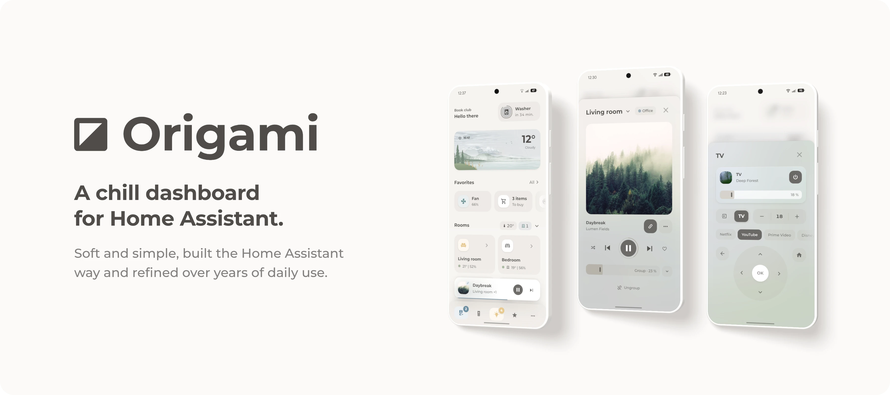
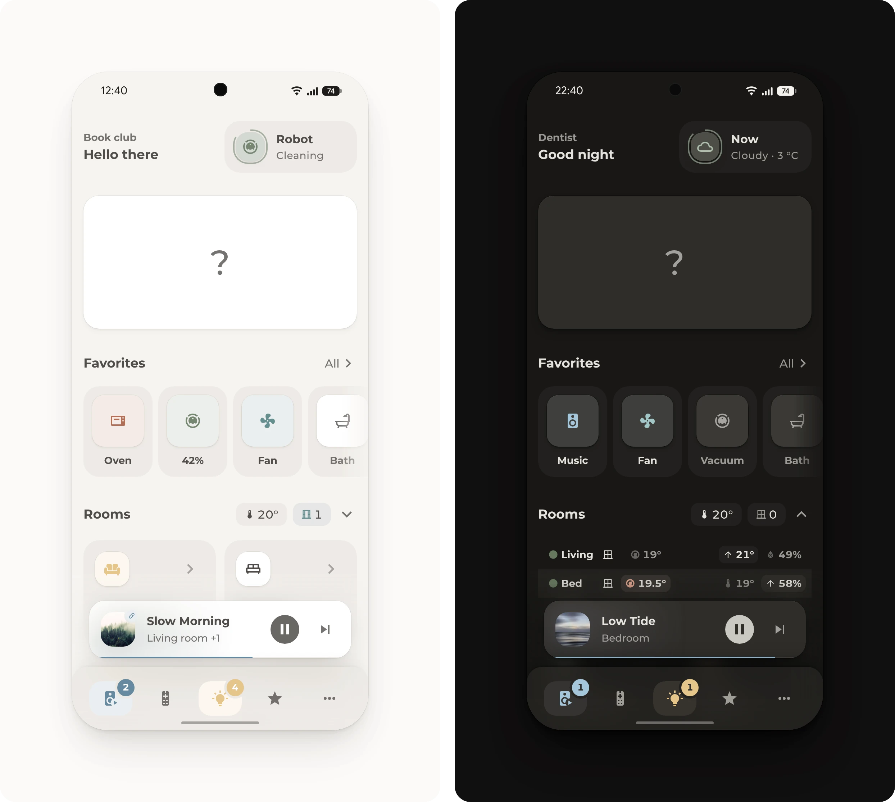

<div>
<a href="https://github.com/hazymorning/origami/releases/latest"></a>
<a href="https://github.com/hazymorning?tab=repositories&q=origami"></a>
</div>

<picture>
  <source media="(prefers-color-scheme: dark)" srcset="https://raw.githubusercontent.com/hazymorning/origami/main/images/v3/hero-dark.webp">
  
</picture>

Origami is a dashboard for Home Assistant, built around [Bubble Card](https://github.com/Clooos/Bubble-Card). It grew and changed over a long time, and at some point it just felt good. So here it is, the result of years of trial and error. Most of it was built by hand on a phone, which is why it's made for phones first.

The idea is that nothing feels overwhelming, everyone at home can use it, and it's nice to look at without trying too hard. Where it can, it uses what Home Assistant already offers and adds as little as possible on top, because less on top means less that can break. It's not the easiest dashboard for beginners and covers quite a lot, but its approaches are a solid foundation that works for most homes and leaves room for endless customization.

[Get started](#get-started) · [Home view](#home-view) · [Pop-ups](#pop-ups) · [More](#more)

## Get started

Start with the theme, the font and Bubble Card. Each part below lists what else it needs.

<details>
<summary><b>Install the theme</b></summary>

<br>

The theme has Origami's colors, sizes and shadows for light and dark mode.

1. If Home Assistant doesn't load themes from the `themes` folder yet, add these lines to [`configuration.yaml`](https://www.home-assistant.io/docs/configuration/#editing-configurationyaml) and restart Home Assistant. If `frontend:` is already there, only the `themes` line goes under it.

   ```yaml
   frontend:
     themes: !include_dir_merge_named themes
   ```

2. Open Origami in HACS. If HACS asks to add the repository, select **Add**. Then select **Download**.

   [](https://my.home-assistant.io/redirect/hacs_repository/?owner=hazymorning&repository=origami&category=theme)

3. Run [`frontend.reload_themes`](https://my.home-assistant.io/redirect/developer_call_service/?service=frontend.reload_themes) and pick **Origami** under **Theme** in the [user profile](https://my.home-assistant.io/redirect/profile/).

> **Light and dark.** Origami and its weather card are made to follow the phone's light and dark mode, which most phones switch with the sun. Light or dark all day works just as well: choose **Light** or **Dark** next to the theme in the user profile.

</details>

<details>
<summary><b>Add the font</b></summary>

<br>

Origami uses the Montserrat font.

1. Open [Resources](https://my.home-assistant.io/redirect/lovelace_resources/) and select **Add resource**.
2. Paste this URL, choose **Stylesheet** and select **Create**.

   ```text
   https://fonts.googleapis.com/css2?family=Montserrat:wght@500;700&display=swap
   ```

3. Reload the page.

To load the font from Home Assistant instead of Google, copy [`www/fonts`](https://github.com/hazymorning/origami/tree/main/www/fonts) to `/config/www/fonts` and use `/local/fonts/montserrat.css` as the URL.

</details>

<details>
<summary><b>Install Bubble Card</b></summary>

<br>

Most of Origami is built with the wonderful [Bubble Card](https://github.com/Clooos/Bubble-Card) by Clooos. Origami needs version 3.4 or later, and [Bubble Card Tools](https://github.com/Clooos/Bubble-Card-Tools) to add its modules.

1. Download Bubble Card and Bubble Card Tools in HACS, or update them if they're already there.

   [Open Bubble Card in HACS](https://my.home-assistant.io/redirect/hacs_repository/?owner=Clooos&repository=Bubble-Card&category=plugin) · [Open Bubble Card Tools in HACS](https://my.home-assistant.io/redirect/hacs_repository/?owner=Clooos&repository=Bubble-Card-Tools&category=integration)

2. Restart Home Assistant. If Bubble Card Tools isn't set up yet, [add it](https://my.home-assistant.io/redirect/config_flow_start/?domain=bubble_card_tools) as an integration.

</details>

<details>
<summary><b>Add a module</b></summary>

<br>

Every module needs Base, so start with that one.

1. Open the module in [`bubble_card/modules`](https://github.com/hazymorning/origami/tree/main/bubble_card/modules) and select **Copy raw file**.
2. In the editor of any Bubble card, or of a new one under **Add card**, open **Modules**, then **My Modules**, and select **Import from YAML**.
3. Paste the module and save.

To add all modules at once, copy the [`bubble_card/modules`](https://github.com/hazymorning/origami/tree/main/bubble_card/modules) folder to `/config/bubble_card/modules` and reload the page. The [module reference](https://github.com/hazymorning/origami/blob/main/bubble_card/README.md) explains every module.

</details>

<details>
<summary><b>Add a card or pop-up</b></summary>

<br>

1. Edit the dashboard and select **Add card**.
2. Choose **Manual**, paste the file's contents and select **Save**.

A pop-up stays hidden until a button opens it with **Navigate** to its hash, such as `#popup_server`. Both need to be in the same view. The parts are made for a view of the type **Sections**.

</details>

## Home view



The start page, from the greeting down to the navigation bar:

- **[Greeting and notifications](https://github.com/hazymorning/origami/tree/main/dashboard/greeting).** Greeting and info on the left, and a notification island on the right.
- **[Weather](https://github.com/hazymorning/origami/tree/main/dashboard/weather).** The weather at a glance, for example as a cute little paper landscape.
- **[Favorites](https://github.com/hazymorning/origami/tree/main/dashboard/favorites).** Quick access to favorites, and to whatever is running right now.
- **[Rooms](https://github.com/hazymorning/origami/tree/main/dashboard/rooms).** How each room is doing, and the way into its pop-up.
- **[Climate table](https://github.com/hazymorning/origami/tree/main/dashboard/climate-table).** All rooms side by side, to see at once where it's too warm, too cold or a window is open.
- **[Navigation bar](https://github.com/hazymorning/origami/tree/main/dashboard/navigation-bar).** The most used pop-ups within thumb's reach, with the music that's playing just above.

### Menu


Truly hides Home Assistant's header and, if wanted, adds a menu that slides down. It uses the Origami Header card, because Home Assistant still has no proper way to hide its header. [More](https://github.com/hazymorning/origami/tree/main/dashboard/menu)

## Pop-ups

### Room


Everything for one room in one place. [More](https://github.com/hazymorning/origami/tree/main/dashboard/room)

### Lights


The home's main light control: its power key turns on the scene for the time of day or turns off every light, and each lamp and scene is a tap away. [More](https://github.com/hazymorning/origami/tree/main/dashboard/lights)

### Music


Music in every room from one place, with speakers grouped as needed. [More](https://github.com/hazymorning/origami/tree/main/dashboard/music)

### TV


The TV's remote on the phone. [More](https://github.com/hazymorning/origami/tree/main/dashboard/tv)

### Fan


A fan's controls, with a timer that turns it off later. [More](https://github.com/hazymorning/origami/tree/main/dashboard/fan)

### Favorites list


Quick access to favorites: other pop-ups, devices, anything really. [More](https://github.com/hazymorning/origami/tree/main/dashboard/favorites-list)

### Server


A look at the server's health, backups and updates. [More](https://github.com/hazymorning/origami/tree/main/dashboard/server)

### Vacuum


Cleaning for the whole home or just one room. [More](https://github.com/hazymorning/origami/tree/main/dashboard/vacuum)

## More

<a name="how-origami-is-built"></a>
<details>
<summary><b>How Origami is built</b></summary>

<br>

Bubble Card does the layout, the actions, the pop-ups and the editor, and Origami only adds what's missing. Each part uses the first of these that works:

1. Bubble Card's own card types and options.
2. An Origami module, where a Bubble card needs another look or behavior.
3. A template in the card, for a value that the card can work out itself, instead of a template sensor.
4. Home Assistant's own helpers and scripts, where a card can't do it alone, such as a timer for the fan or the steps of a thermostat. Scripts get their entities from the card, so they work in any home as they are.
5. A card of its own, only for a gap that nothing else fills, as with Origami Weather, Origami Notifications and Origami Header.

So the look stays in one place, and every part follows the theme.

</details>

<details>
<summary><b>Coming from 2.0</b></summary>

<br>

Updating Origami in HACS only updates the theme. The Bubble Card modules were copied in by hand, so they're updated the same way.

1. Update Origami and Bubble Card in HACS.
2. Paste all the new modules over the old ones. The new parts need them.
3. Make the small change that the [upgrade steps](https://github.com/hazymorning/origami/blob/main/CHANGELOG.md#upgrading) list for a few cards.

The 2.0 dashboard keeps working, and the new parts can take the place of the old cards one at a time. The [changelog](https://github.com/hazymorning/origami/blob/main/CHANGELOG.md) also has which part replaces which card and what looks different on the old ones.

</details>

<details>
<summary><b>Change the colors</b></summary>

<br>

1. Copy [`themes/origami.yaml`](https://github.com/hazymorning/origami/blob/main/themes/origami.yaml) to `/config/themes` under a new name, such as `my-origami.yaml`.
2. In the copy, change `Origami:` at the top to a new name, then change the colors. The comments in the file say what each group of settings does.
3. Run [`frontend.reload_themes`](https://my.home-assistant.io/redirect/developer_call_service/?service=frontend.reload_themes) and select the new theme in the [user profile](https://my.home-assistant.io/redirect/profile/).

Most changes need a few lines: `primary-color` and `accent-color` in each mode for the accent, `radius-ratio` for how round the controls are, and a state color, such as `state-light-active-color: var(--orange-color)`, for one kind of device. Leave the original file alone, since an update replaces it.

</details>

<details>
<summary><b>Troubleshooting</b></summary>

<br>

- **Origami isn't in the theme list.** Add the `themes` line from [Get started](#get-started) to `configuration.yaml` and restart Home Assistant.
- **HACS can't find Origami.** The **Open in HACS** button under [Get started](#get-started) adds the repository to HACS.
- **A card says "Custom element doesn't exist".** Download the card in HACS and reload the page. In the Companion app, select **Reset frontend cache** in the app settings.
- **The font doesn't change.** Check that the stylesheet is under [Resources](https://my.home-assistant.io/redirect/lovelace_resources/), then reload the page.
- **A Bubble card looks plain.** Check that Bubble Card Tools is added as an integration and that the card's modules are under **Modules**, then **My Modules**. Then reload the page.
- **A tap doesn't open a pop-up.** The pop-up has to be in the same view as the button, and its `hash` has to match the button's navigation path, such as `#popup_tv`.
- **The header and its edit button are gone.** The [menu](https://github.com/hazymorning/origami/tree/main/dashboard/menu) hides them. **Edit** in the menu, or `?edit=1` at the end of the address, opens edit mode.

</details>

<details>
<summary><b>Using an AI assistant</b></summary>

<br>

Many details in Origami look like they could be done in an easier way, but most of them came out of a lot of trial and error on real phones: why a value is worked out in the card instead of a template sensor, why a pop-up uses a mini pop-up instead of a helper, or why a size comes from the theme instead of the card. An AI assistant doesn't know that history, so where it has to guess, it often undoes one of these choices without noticing. These steps give it what it needs:

- Give it the files of the part, not a link or a screenshot. It can only follow what it can read, and a screenshot doesn't show the options behind the look.
- Ask it to read the part's README and the [module reference](https://github.com/hazymorning/origami/blob/main/bubble_card/README.md) before it writes anything. They say which options exist and why a part is built the way it is, so it doesn't make up options that the modules don't have.
- Ask it to build in the order under [How Origami is built](#how-origami-is-built), so the part still fits the rest of the dashboard after an update. Never card-mod, because it writes over the same styles as the modules, and the two get in each other's way.
- Give it the real entity IDs. It can't see Home Assistant, so it makes up any ID it doesn't get, and a part with a made-up ID doesn't work.
- Keep a copy of the configuration before pasting anything, so a change that goes wrong is easy to undo.

</details>
