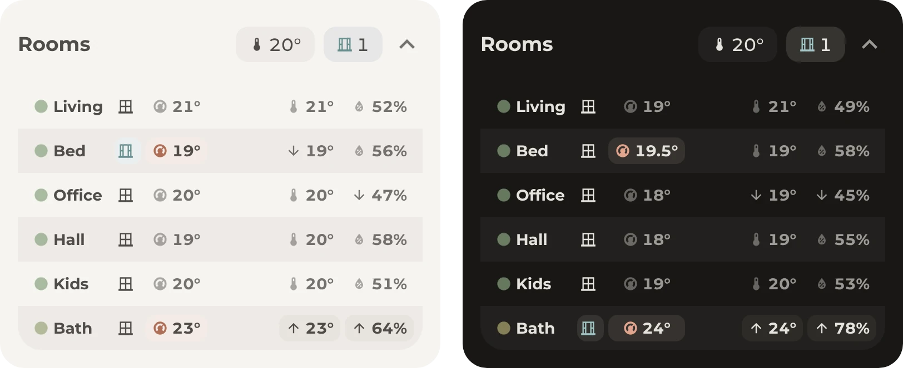

# Climate table

Every room in one table, with its temperature, humidity, windows and heating. Arrows mark the warmest, the coldest, the most humid and the driest room.

## Requirements

- [Get started](../../README.md#get-started), with the modules Base and Table
- A **Toggle** helper named **Climate table**, which opens and closes the table
- Optional: the [rooms header](../rooms/README.md), whose chevron opens the table

## Setup

1. Open [Helpers](https://my.home-assistant.io/redirect/helpers/) under **Settings**, **Devices & services** and select **Create helper**, then **Toggle**. Name it **Climate table**, so its entity ID is `input_boolean.climate_table`, and select **Create**.
2. In [`card.yaml`](card.yaml), change each row to one of the home's rooms, with a short name such as **Living**, so the table fits on a phone. To add a room, copy a row. A room without a window contact or a thermostat leaves out that cell, as the office does.
3. In the columns `temperature` and `humidity`, list the sensors of all rows in each of the three templates, so the arrows compare every room.
4. Add [`card.yaml`](card.yaml) to the dashboard, as described under [Get started](../../README.md#get-started), such as right below the rooms header.
5. Optional: to close the table after 3 minutes, open [Automations](https://my.home-assistant.io/redirect/automations/) under **Settings**, **Automations & scenes** and select **Create automation**, then **Create new automation**. In the three-dot menu, select **Edit in YAML**, paste [`close-table.yaml`](close-table.yaml) and save it.

The table only shows while **Climate table** is on, and the chevron in the [rooms header](../rooms/README.md) turns it on and off. To keep it on screen all the time, skip steps 1 and 5 and delete the `visibility` lines in [`card.yaml`](card.yaml).

## Entities

| Entity | Used for |
| --- | --- |
| `sensor.living_room_temperature`, `sensor.bedroom_temperature`, `sensor.office_temperature` | The temperature and its arrows, and the dot before the name, from blue when it's cold over green to red when it's hot |
| `sensor.living_room_humidity`, `sensor.bedroom_humidity`, `sensor.office_humidity` | The humidity and its arrows |
| `binary_sensor.living_room_window`, `binary_sensor.bedroom_window` | The windows, which stand out while open |
| `climate.living_room`, `climate.bedroom` | The target temperature, which stands out while the thermostat heats. A tap opens the thermostat. |
| `input_boolean.climate_table` | Shows the table while it's on |
