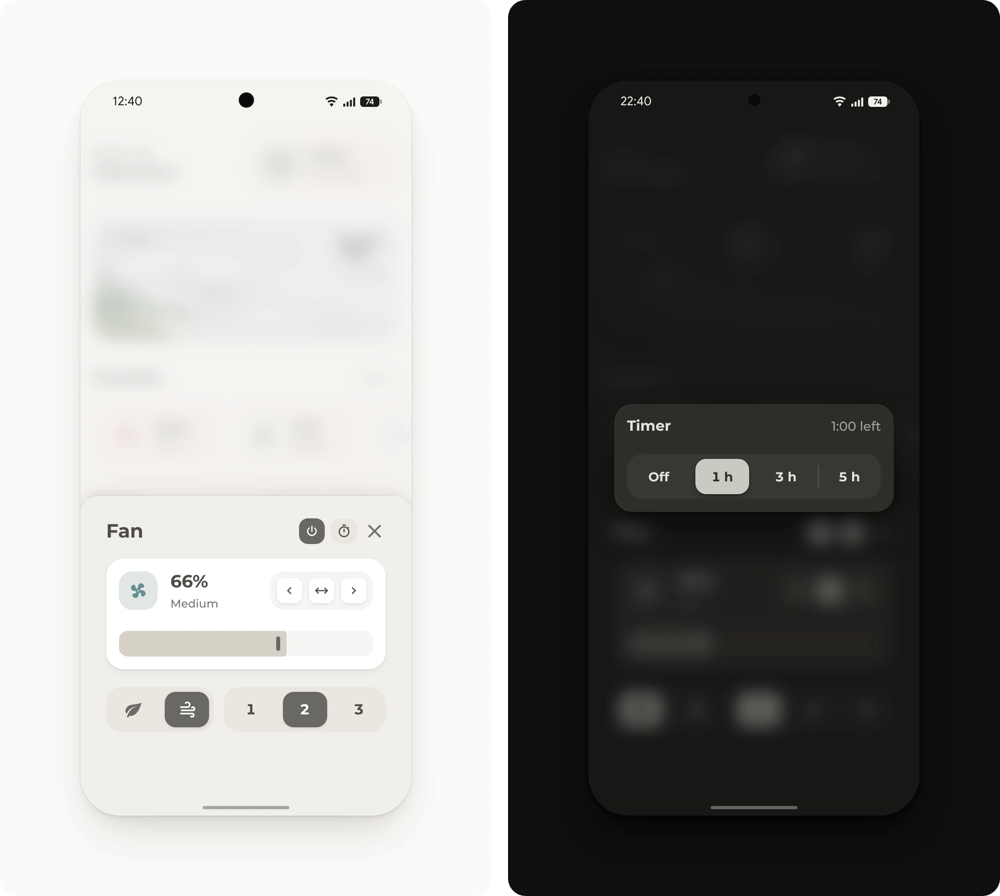

# Fan pop-up

Speed, mode, timer and oscillation in one pop-up. The timer turns the fan off after 1, 3 or 5 hours.

## Requirements

- [Get started](../../README.md#get-started), with the modules Base, Popup, Header, Fan and Button
- Optional: a [timer](https://www.home-assistant.io/integrations/timer/) helper and the automation [`fan-timer.yaml`](fan-timer.yaml), for the timer

## Setup

1. Open [Helpers](https://my.home-assistant.io/redirect/helpers/) under **Settings**, **Devices & services** and select **Create helper**, then **Timer**. Name it **Bedroom fan**, so its entity ID is `timer.bedroom_fan`, turn on **Restore state and time when Home Assistant starts** and select **Create**.
2. Open [Automations](https://my.home-assistant.io/redirect/automations/) under **Settings**, **Automations & scenes** and select **Create automation**, then **Create new automation**. In the three-dot menu, select **Edit in YAML**, paste [`fan-timer.yaml`](fan-timer.yaml), change `fan.bedroom` to the fan's entity ID and save it.
3. In [`pop-up.yaml`](pop-up.yaml), change `fan.bedroom` to the fan's entity ID and `Nature` and `Normal` to its presets, as [States](https://my.home-assistant.io/redirect/tools_states/) under **Settings**, **Tools** lists them in `preset_modes`. Delete the controls that the fan doesn't have, such as the mode buttons, the oscillation keys or the arrows.
4. Add [`pop-up.yaml`](pop-up.yaml) to the dashboard, as described under [Get started](../../README.md#get-started).
5. Open the pop-up from a button whose tap action is **Navigate** to `#popup_fan`, such as the fan in the [favorites list](../favorites-list/README.md).

Without the timer, skip steps 1 and 2, and delete `mini_popups` and the timer key in the title from [`pop-up.yaml`](pop-up.yaml).

## Entities

| Entity | Used for |
| --- | --- |
| `fan.bedroom` | The fan with its speed, presets and oscillation. The arrows set its direction, which turns the head of some fans, such as Xiaomi fans. |
| `timer.bedroom_fan` | The timer. When it finishes, the automation turns the fan off. |
