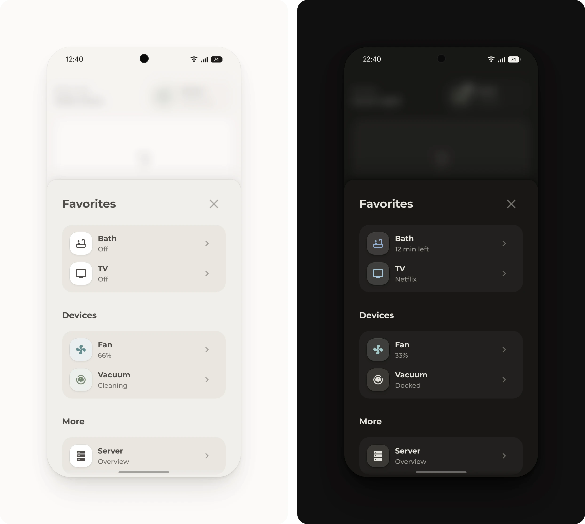

# Favorites list

A list of favorites, like other pop-ups, devices or anything else worth a shortcut.

## Requirements

- [Get started](../../README.md#get-started), with the modules Base, Popup, Header and Tiles

## Setup

1. In [`pop-up.yaml`](pop-up.yaml), keep the rows that fit, delete the others and change their entities. To add a row, copy one and change its entity and tap action.
2. Add [`pop-up.yaml`](pop-up.yaml) to the dashboard, as described under [Get started](../../README.md#get-started).
3. Open the pop-up from a button whose tap action is **Navigate** to `#popup_favorites`, such as **All** in the [favorites](../favorites/README.md) header.

## Optional

- **Other pop-ups.** The rows for the TV, the fan, the vacuum and the server open the [TV](../tv/README.md), [fan](../fan/README.md), [vacuum](../vacuum/README.md) and [server](../server/README.md) pop-ups. Without one of them, change that row's tap action.
- **Calendar, shopping list and map.** For a home with a [calendar](https://www.home-assistant.io/integrations/calendar/), the [shopping list](https://www.home-assistant.io/integrations/shopping_list/) or people in Home Assistant. The rows under **More** open them, with the next event, the open items and how many people are home at their end. Without one of them, delete its row.

## Entities

All rows are examples from one home.

| Entity | Used for |
| --- | --- |
| `input_boolean.bath_time`, `input_datetime.bath_time_end` | The bath, with the minutes left while it runs. The end time comes from an automation of its own. |
| `media_player.living_room_tv` | The TV. While it's off, a tap turns it on, and then the row opens the TV pop-up. |
| `fan.bedroom` | The fan and its speed |
| `vacuum.robot` | The vacuum and its state |
| `calendar.household` | The calendar and its next event |
| `todo.shopping_list` | The shopping list and its open items |
| `zone.home` | The map and how many people are home. It comes with Home Assistant. |
