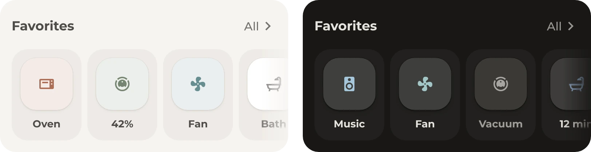

# Favorites

Favorites for whatever matters right now, like a running vacuum or tonight's dinner. Most of them only show up when they're needed. They come in two versions with the same favorites:

- [`row.yaml`](row.yaml): a row of boxes with an icon and a short name, which scrolls sideways when they don't fit, as in the image
- [`tiles.yaml`](tiles.yaml): a grid of tiles with a state line under each name, as in the [Tiles module](../../bubble_card/README.md#tiles)

## Requirements

- [Get started](../../README.md#get-started), with the modules Base and Header, and Button for the row or Tiles for the grid

## Setup

1. Pick the row or the grid. In its file, keep the favorites that fit, delete the others and change their entities. A comment above each favorite says when it shows. To add one, copy a favorite and change its entity and its visibility conditions.
2. Add [`header.yaml`](header.yaml) and then the file of the row or the grid to the dashboard, as described under [Get started](../../README.md#get-started).

## Optional

- **Other pop-ups.** **All** in the header opens the [favorites list](../favorites-list/README.md), and a tap on the music, the fan, the oven or the vacuum opens its pop-up. Without one of them, change that tap action.

## Entities

All favorites are examples from one home, the same in both versions.

| Favorite | Entities | Shows |
| --- | --- | --- |
| Oven | `sensor.oven` | While the oven is on, always first |
| Vacuum | `vacuum.robot`, `sensor.robot_cleaning_progress` | Always. While it cleans, it moves to the front and shows its progress. |
| Fan | `fan.bedroom`, `sensor.living_room_temperature`, `sensor.bedroom_temperature` | While the fan runs or a room is above 24° |
| Dinner | `sensor.dinner` | From 14:00 to 21:00, with the photo from its `recipe.image` attribute, such as from [Tandoor](https://tandoor.dev) |
| Music | `media_player.bedroom` | From 22:00 to 4:00 |
| Bath | `input_boolean.bath_time`, `input_datetime.bath_time_end` | From 11:00 to 23:00 and while it runs, with the minutes left |
| Printer | `switch.printer`, `input_datetime.printer_end` | Always, with the minutes left while it prints |

The bath and the printer read their end time from an `input_datetime` helper, which needs an automation to set it.
