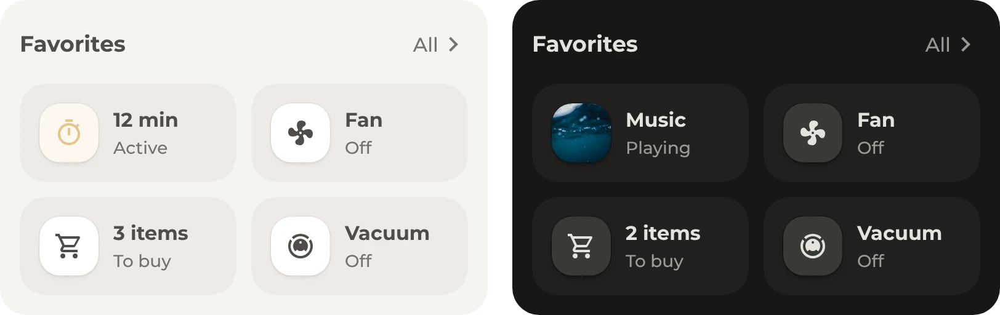

# Favorites

Favorites for whatever matters right now, like a kitchen timer or the vacuum while it cleans. Most of them only show up when they're needed. The tiles stand in one row that scrolls sideways, which takes little room on a phone, or in a grid that shows them all at once, which suits a larger screen, such as a tablet on the wall.

## Requirements

- [Get started](../../README.md#get-started), with the modules Base, Header and Tiles

## Setup

1. In [`tiles.yaml`](tiles.yaml), keep the favorites that fit, delete the others and change their entities. A comment above each favorite says when it shows. To add one, copy a favorite and change its entity and its visibility conditions.
2. For the grid, delete the two lines with `scroll`.
3. Add [`header.yaml`](header.yaml) and then `tiles.yaml` to the dashboard, as described under [Get started](../../README.md#get-started).

## Optional

- **Other pop-ups.** **All** in the header opens the [favorites list](../favorites-list/README.md), and a tap on the music, the fan, the TV or the vacuum opens its pop-up. Without one of them, change that tap action.

## Entities

All favorites are examples from one home.

| Favorite | Entities | Shows |
| --- | --- | --- |
| Timer | `timer.kitchen` | While it runs or is paused, always first, with the minutes left |
| Vacuum | `vacuum.robot`, `sensor.robot_cleaning_progress` | Always. While it cleans, it moves to the front and shows its progress. For a vacuum without such a sensor, delete its `name` under `origami_tiles`. |
| Fan | `fan.bedroom`, `sensor.living_room_temperature`, `sensor.bedroom_temperature` | While the fan runs or a room is above 24° |
| Shopping | `todo.shopping_list` | While the list has items, and a tap opens it |
| TV | `media_player.living_room_tv` | While the TV is on |
| Music | `media_player.bedroom` | While the speaker plays, with the cover as its picture |
