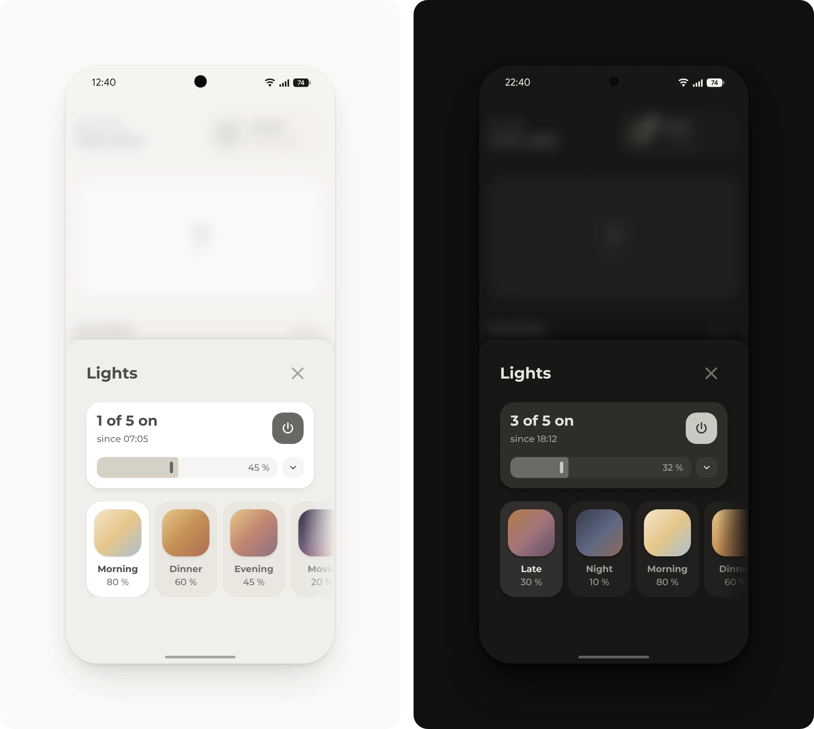

# Lights pop-up

Scenes, all lamps at once, or each lamp on its own. The scenes start with the one for the time of day, and the last one turned on stays highlighted while a lamp is on.

## Requirements

- [Get started](../../README.md#get-started), with the modules Base, Popup, Button, Header and Slider
- A [scene](https://www.home-assistant.io/docs/scene/) for each scene button
- A [light group](https://www.home-assistant.io/integrations/group/) with the room's lamps

## Setup

1. Open [Helpers](https://my.home-assistant.io/redirect/helpers/) under **Settings**, **Devices & services** and select **Create helper**, then **Group** and **Light group**. Name it **Living room**, so its entity ID is `light.living_room`, choose the room's lamps as **Members** and select **Submit**.
2. In [`pop-up.yaml`](pop-up.yaml), change the lamps and the scenes to the room's own, and list the same scenes under `active`.
3. Add [`pop-up.yaml`](pop-up.yaml) to the dashboard, as described under [Get started](../../README.md#get-started).
4. Open the pop-up from a button whose tap action is **Navigate** to `#popup_lights`.

> [!TIP]
> Each scene's `css_class`, such as `evening`, picks the colors of its circle under `styles`, and `start` names a class for each time of day, so the row begins with the scene that fits. A class without colors gets a gray circle.

## Entities

| Entity | Used for |
| --- | --- |
| `light.living_room` | The light group: the power button, the slider for all lamps and how many lamps are on |
| `light.living_room_floor_lamp`, `light.living_room_string_lights`, `light.living_room_tv`, `light.living_room_table_lamp`, `light.living_room_ceiling` | A row for each lamp |
| `scene.living_room_night`, `scene.living_room_morning`, `scene.living_room_dinner`, `scene.living_room_evening`, `scene.living_room_movie`, `scene.living_room_late` | The scene buttons |
