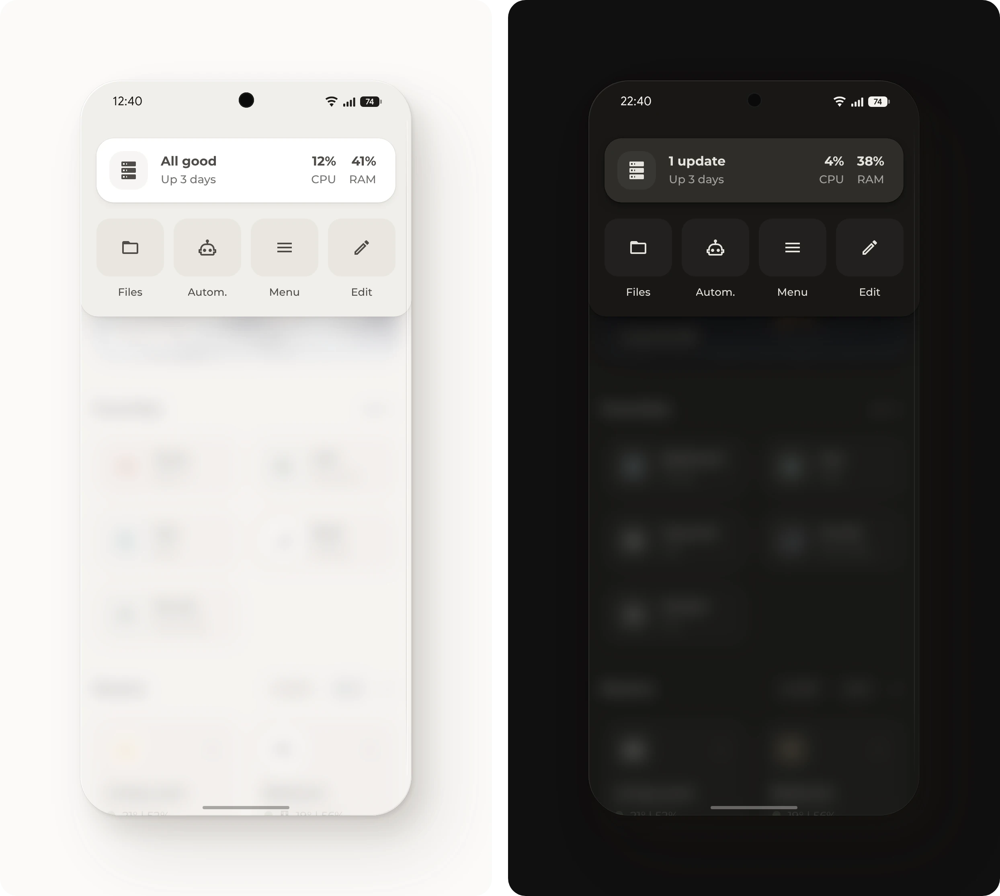

# Menu



Hides Home Assistant's header and adds a menu that slides in from the top, with shortcuts and a card for the server. Unlike other ways to hide the header, it never shows for a moment while the page loads.

## Requirements

- [Get started](../../README.md#get-started), with the Base module
- [Origami Header](https://github.com/hazymorning/origami_header) from HACS, which needs Home Assistant 2026.9 or later
- For the server card: [System Monitor](https://www.home-assistant.io/integrations/systemmonitor/) with four sensors turned on, as described for the [server pop-up](../server/README.md#setup), and automatic backups

## Setup

1. [Open Origami Header in HACS](https://my.home-assistant.io/redirect/hacs_repository/?owner=hazymorning&repository=origami_header&category=plugin). If HACS asks to add the repository, select **Add**. Then select **Download**.
2. Add these lines to [`configuration.yaml`](https://www.home-assistant.io/docs/configuration/#editing-configurationyaml) and restart Home Assistant. If `frontend:` is already there, add only the `extra_module_url` lines under it.

   ```yaml
   frontend:
     extra_module_url:
       - /hacsfiles/origami_header/origami-header.js
   ```

3. In [`card.yaml`](card.yaml), change or delete the buttons that don't fit. **Files** opens the File editor app.
4. Add [`card.yaml`](card.yaml) to the dashboard, as described under [Get started](../../README.md#get-started). The header is gone from then on. To edit the dashboard, select **Edit** in the menu or add `?edit=1` to the address.
5. Open the menu from a button with this tap action:

   ```yaml
   tap_action:
     action: fire-dom-event
     origami_header: toggle
   ```

A tap on the server card opens the [server pop-up](../server/README.md), and a tap on CPU or RAM opens its history.

## Entities

| Entity | Used for |
| --- | --- |
| `sensor.system_monitor_processor_use`, `sensor.system_monitor_memory_usage` | CPU and RAM, and the top line |
| `sensor.system_monitor_disk_usage` | The top line |
| `sensor.system_monitor_uptime` | The uptime |
| `sensor.backup_last_successful_automatic_backup` | The top line, which says **Backup due** after 3 days without a backup |
