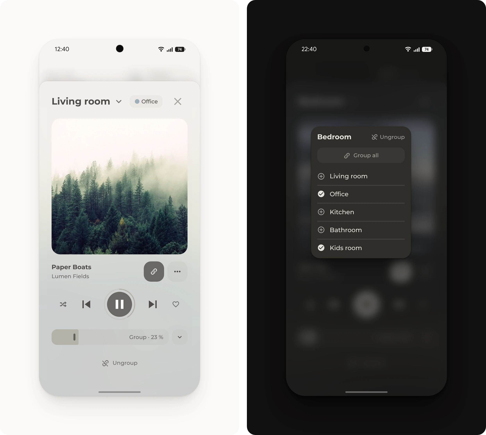
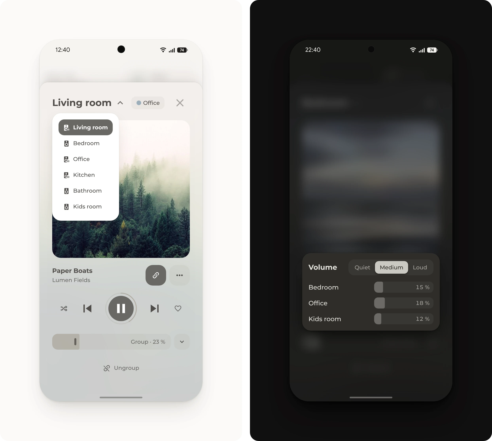

# Music pop-up





Music on any speaker at home, picked in the title. The cover, the keys and the volume follow the speaker, and speakers that can play together get a group. The pop-up stays light on purpose, so it opens fast: one music card, with the rest in small pop-ups on top.

## Requirements

- [Get started](../../README.md#get-started), with the modules Base, Popup, Media, Slider, Button, Header and Tiles

## Setup

<details>
<summary><b>Create the speaker helper</b></summary>

<br>

The pop-up shows the speaker that this helper picks.

1. Open [Helpers](https://my.home-assistant.io/redirect/helpers/) and select **Create helper**, then **Dropdown**.
2. Name it **Selected speaker**, so its entity ID is `input_select.selected_speaker`.
3. Add each speaker's entity ID as an option, such as `media_player.living_room`, and select **Create**.

</details>

<details>
<summary><b>Add the scripts</b></summary>

<br>

**Playback** runs the keys of the play row, and **Set group volume** sets the volume of a speaker and the speakers in its group.

1. Open [Scripts](https://my.home-assistant.io/redirect/scripts/) and select **Create script**, then **Create new script**.
2. In the three-dot menu, select **Edit in YAML**, paste [`playback.yaml`](playback.yaml) and save it as **Playback**.
3. Add [`set-group-volume.yaml`](set-group-volume.yaml) the same way, as **Set group volume**.

</details>

<details>
<summary><b>Create the volume helper</b></summary>

<br>

The volume slider shows this helper: the speaker's volume, or the average of its group.

1. Open [Helpers](https://my.home-assistant.io/redirect/helpers/) and select **Create helper**, then **Template** and **Number**.
2. Name it **Group volume**, so its entity ID is `number.group_volume`, and set **Unit of measurement** to `%`.
3. Paste this as the **State**:

   ```jinja
   
   
   {{ (v | sum / v | count * 100) | round if v else 0 }}
   ```

4. Under **Actions on set value**, select **Add action** and choose the script **Set group volume**. In the action's three-dot menu, select **Edit in YAML**, replace the text with these lines and select **Submit**.

   ```yaml
   action: script.set_group_volume
   data:
     speaker: input_select.selected_speaker
     volume: "{{ value }}"
   ```

</details>

<details>
<summary><b>Change the speakers</b></summary>

<br>

Each speaker shows up three times in [`pop-up.yaml`](pop-up.yaml): as a chip beside the title under `sub_button`, as a row in the group under `group:` and as a slider in the volume under `volume:`.

1. Replace the example speakers with the home's own in all three places.
2. For more speakers, copy all three parts of a speaker. For fewer, delete them.

</details>

<details>
<summary><b>Add the pop-up</b></summary>

<br>

1. Add [`pop-up.yaml`](pop-up.yaml) to the dashboard, as described under [Get started](../../README.md#get-started).
2. Open it from a button whose tap action is **Navigate** to `#popup_music`.

</details>

## Optional

- **Speaker groups.** For speakers that Home Assistant can group, such as [Sonos](https://www.home-assistant.io/integrations/sonos/), [LinkPlay](https://www.home-assistant.io/integrations/linkplay/) or the players of [Music Assistant](https://www.home-assistant.io/integrations/music_assistant/). The link key opens the group, and while speakers play together, the key after the volume slider opens the volume of each one. Add [`group-speakers.yaml`](group-speakers.yaml) as a script named **Group speakers**, the same way as the other scripts. Without groups, delete `group:` and the link key.
- **Shortcuts.** The dots open a short list, with room for more, like playlists or radio stations. Under `more:`, keep what fits and delete the rest, or delete `more:` and the dots key. The examples switch the living room speaker to Bluetooth or the TV while it's the selected speaker, and turn an amplifier's display on and off. For the TV, change `Optical In` to the name of the speaker's TV input, also under `words`.
- **Open with a speaker.** For a home with several speakers. Another card, such as a room's speaker, opens the pop-up with its own speaker selected. A tap action can open the pop-up or select a speaker, but not both, so a script does both. Create a **Toggle** helper named **Music pop-up**, so its entity ID is `input_boolean.music_pop_up`, add [`open-music.yaml`](open-music.yaml) as a script named **Open music**, the same way as the other scripts, and add these lines to `pop-up.yaml`, so the pop-up opens when the helper turns on. It then opens on every screen that shows the dashboard at that moment.

  ```yaml
  trigger:
    - condition: state
      entity: input_boolean.music_pop_up
      state: 'on'
  trigger_close: false
  open_action:
    action: perform-action
    perform_action: input_boolean.turn_off
    target:
      entity_id: input_boolean.music_pop_up
  ```

  The other card's tap action then runs the script with its speaker. Without `speaker`, the pop-up shows the speaker that plays, if only one does.

  ```yaml
  tap_action:
    action: perform-action
    perform_action: script.open_music
    data:
      speaker: media_player.living_room
      dropdown: input_select.selected_speaker
      pop_up: input_boolean.music_pop_up
  ```

## Entities

| Entity | Used for |
| --- | --- |
| `input_select.selected_speaker` | The speaker the pop-up shows, picked in the title |
| `media_player.living_room`, `media_player.bedroom`, `media_player.office` | The speakers. When one plays on its own, its chip shows beside the title, and a tap switches to it. |
| `number.group_volume` | The volume slider and the levels **Quiet**, **Medium** and **Loud** |
| `script.playback` | The play row. The heart saves the song in Music Assistant and is grayed out on other speakers. |
| `script.set_group_volume` | Sets the volume of the speaker and its group, and keeps the balance between the speakers |
| `script.group_speakers` | Speaker groups: adds a speaker, takes it out, groups all free speakers or ends the group. A free speaker plays nothing and uses no input. |
| `input_boolean.music_pop_up` | Open with a speaker: opens the pop-up when it turns on |
| `script.open_music` | Open with a speaker: selects the speaker and opens the pop-up |
| `light.living_room_display` | The amplifier's display, among the shortcuts |
