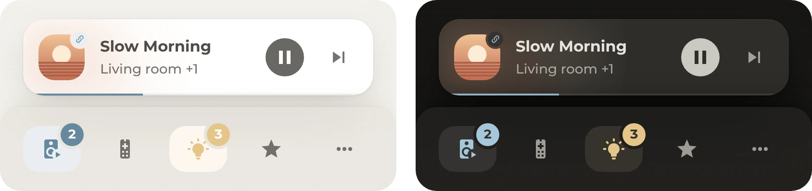

# Navigation bar

Opens the most used pop-ups and the menu from the bottom of the screen, and shows what's playing. Holding the music button plays or pauses the music, and holding the lights button opens a list that turns the lights off or on and sets a scene.

## Requirements

- [Get started](../../README.md#get-started), for the theme and the font
- [Navbar Card](https://github.com/joseluis9595/lovelace-navbar-card) from HACS
- Optional: the [menu](../menu/README.md), which the menu button opens
- Optional: [Google Cast](https://www.home-assistant.io/integrations/cast/), for the TV in the now playing card

## Setup

1. [Open Navbar Card in HACS](https://my.home-assistant.io/redirect/hacs_repository/?owner=joseluis9595&repository=lovelace-navbar-card&category=plugin) and select **Download**.
2. In [`card.yaml`](card.yaml), keep the buttons under `routes` that fit and delete the others. Under `media_player`, the first player is for the music and the second one for the TV through Google Cast. Delete the ones that don't apply.
3. Change the entities to the home's own, as listed under [Entities](#entities). The speakers are in several lists, under the music button and in the first player, so change each list.
4. Add [`card.yaml`](card.yaml) to the dashboard, as described under [Get started](../../README.md#get-started). The bar stands at the bottom of the screen, wherever the card is in the view.

The buttons open the music pop-up at `#popup_music`, the [TV pop-up](../tv/README.md), the lights pop-up at `#popup_lights` and the [favorites list](../favorites-list/README.md). Each pop-up is optional, and it has to be in the same view as the bar. On a wider screen, the bar stands at the right edge, without the now playing card.

## Entities

| Entity | Used for |
| --- | --- |
| `media_player.living_room`, `media_player.bedroom`, `media_player.office` | The speakers. The music button counts the ones that play. The now playing card shows the speaker that plays music, or else one that is paused. For a group, it names the first speaker and counts the others. |
| `media_player.living_room_tv` | The TV button, filled while the TV is on. Holding it opens the TV's more-info dialog. |
| `media_player.living_room_tv_cast` | The TV in the now playing card, while it plays something through Google Cast |
| `light.living_room` | **Turn on** in the lights list |
| `scene.living_room_evening`, `scene.living_room_dinner`, `scene.living_room_movie`, `scene.living_room_late`, `scene.living_room_night` | The scenes in the lights list. While `light.living_room` is on, the scene turned on last is highlighted. |

The lights button counts every light that is on, without light groups, and **Turn off** turns off every light. For administrators, the menu button shows a dot while an update waits.
