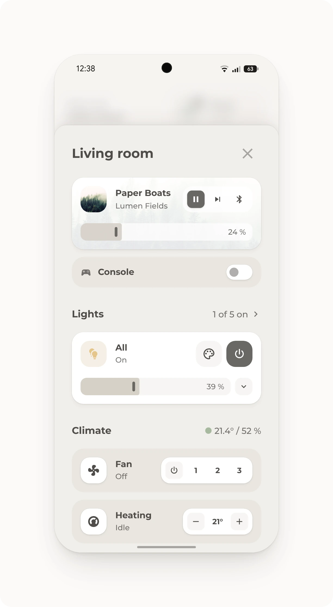
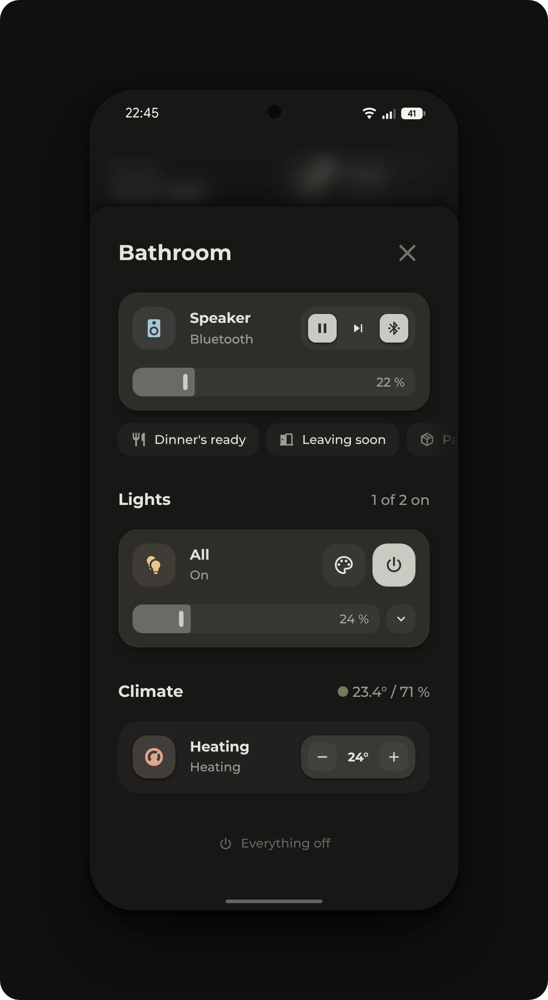
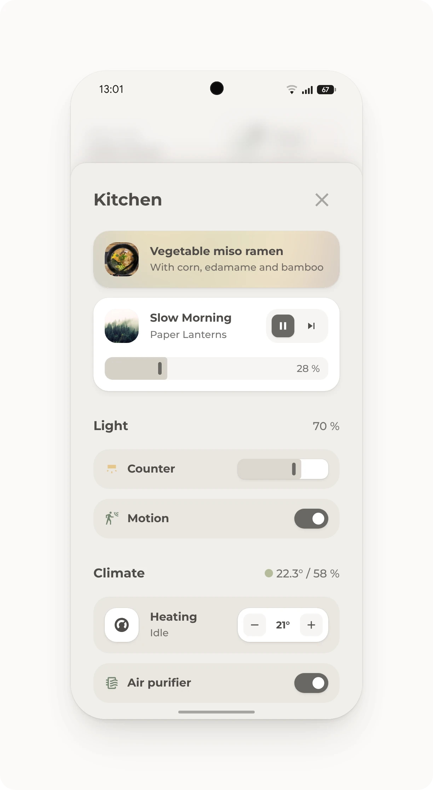
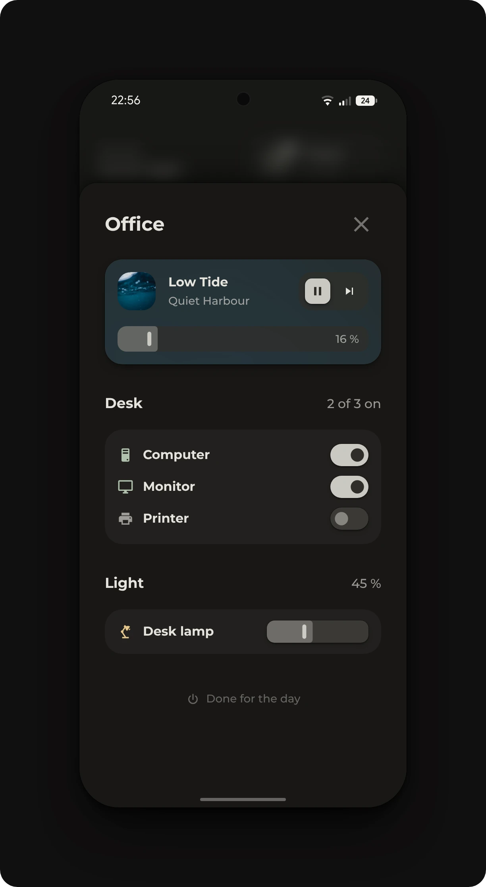

# Room pop-up

A room's media, lights and climate in one pop-up, made of blocks for the room's devices. Each block works in any room.

### Living room

A TV that plays through the speaker, a fan and lamps with scenes. [`living-room.yaml`](living-room.yaml)

### Bathroom

Announcements on the speaker, such as that dinner's ready. [`bathroom.yaml`](bathroom.yaml)

### Kitchen

Tonight's dinner on top, and a light that turns on with motion. [`kitchen.yaml`](kitchen.yaml)

### Office

A desk with three devices on plugs, which **Done for the day** turns off with the lamp. [`office.yaml`](office.yaml)

## Requirements

- [Get started](../../README.md#get-started), with the modules Base, Popup, Header and Button. Media, Slider, Fan and Climate are only for the blocks below that name them.

## Setup

1. Pick the example above that's closest to the room.
2. Go through the blocks below. Keep the ones for devices that the room has, set them up as each one says, and delete the others.
3. Change the entities to the room's own. **Everything off**, or the office's **Done for the day**, turns off the entities in its list. Leave speakers out of it, since some, like Sonos, can't be turned off and make it fail.
4. Add the file to the dashboard, as described under [Get started](../../README.md#get-started).
5. Open the pop-up from a button whose tap action is **Navigate** to its hash, such as `#popup_living_room`, or from a [room card](../rooms/README.md).
6. For each further room, add a copy with its own `hash`, `name` and entities.

## Optional

Each block is only for a room that has its device.

### Media

- **Speaker.** For a room with a speaker, as in every example. A tap opens the [music pop-up](../music/README.md), or change its tap action. With [Open with a speaker](../music/README.md#optional), change its `tap_action`, and the `tap_action` under `button_action`, to the lines there with the room's speaker, so the pop-up opens with that speaker selected. It needs the Media module.
- **TV.** For a TV whose sound plays through the room's speaker, as in the living room. The TV card takes the speaker's place while the speaker uses its TV input, so change `Optical In` to the name of that input. With [Google Cast](https://www.home-assistant.io/integrations/cast/), it also shows what's cast to the TV. A tap opens the [TV pop-up](../tv/README.md). For a TV without a separate speaker, delete both `conditional` cards, put the TV card from the first one in their place and point its slider to the TV. It needs the Media module.
- **Announcements.** For a room with a speaker, as in the bathroom. Each chip says its message on the speaker through `tts.speak`, so change the names and the messages. It needs a text-to-speech engine, such as [Google Translate text-to-speech](https://www.home-assistant.io/integrations/google_translate/), whose entity takes the place of `tts.google_translate_en_com`.
- **Up next.** For something the room looks forward to, as tonight's dinner in the kitchen. Any entity with a picture works, such as a meal planner's dinner or the next episode of a series. The card's name shows its state, the line below the attribute under `state_content`, and Base's `art` shows the picture in the icon and softly behind the card. Change `description` and `entity_picture` to the entity's own attributes.

### Lights

- **Lamps.** For a room with lamps, as in the living room and the bathroom. **All** switches and dims them together, its palette opens the scenes, and the arrow beside its slider a row for each lamp. The header counts the lamps that are on. In the living room, a tap on it opens the [lights pop-up](../lights/README.md). In another room, or without the lights pop-up, its `tap_action` is `action: more-info`, as in the bathroom. Unless the room has a light group already, open [Helpers](https://my.home-assistant.io/redirect/helpers/) and select **Create helper**, then **Group** and **Light group**, and add the room's lamps. The lamps and the scenes are under `mini_popups`, and each scene is also listed under `active`. Without scenes, delete `scenes` under `mini_popups` and the palette key. It needs the Slider module.
- **Lamp.** For a room with one lamp, as in the kitchen and the office. Its row has a slider, and the header shows its brightness.
- **Motion.** For a light that an automation turns on with motion, as in the kitchen. The row's switch turns the automation off while it's in the way and on again.

### Climate

- **Climate.** For a room with a temperature sensor. The header shows the temperature and the humidity, with a dot from blue for cold to red for hot. Without a humidity sensor, delete the `name` under the temperature, and the header shows the temperature alone. Without a temperature sensor, delete the temperature under the header's `sub_button`, and the header stays for the fan and the thermostat below it.
- **Fan.** For a room with a fan, as in the living room: its three speeds, and a tap opens the [fan pop-up](../fan/README.md), which shows one fan, so it needs the same fan. The card hides while the fan is unavailable. It needs the Fan module.
- **Thermostat.** For a room with a thermostat. Its minus and plus move the target by half a degree through a script, since Home Assistant has no action that moves a target by a step. Open [Scripts](https://my.home-assistant.io/redirect/scripts/) and select **Create script**, then **Create new script**. In the three-dot menu, select **Edit in YAML**, paste [`thermostat-step.yaml`](thermostat-step.yaml) and save it with the name **Thermostat step**. It needs the Climate module.

### Devices

- **Plug.** For a device on a smart plug, as the living room's console, the kitchen's air purifier and the office's desk. Each plug is a row with a switch. Several plugs share one background with Base's `join`, as on the office's desk, whose header counts the ones that are on.

> [!TIP]
> The more-info dialog of a light group, which the bathroom's **Lights** header opens, lists each lamp with its own brightness and color. So each lamp of a room can be set on its own, such as a color for just one of them.

> [!TIP]
> Base's [`words`](../../bubble_card/README.md#language) option renames a word on one card, such as `Ein: An` in German.

## Entities

### Living room

| Entity | Used for |
| --- | --- |
| `media_player.living_room` | The speaker |
| `media_player.living_room_tv` | The TV |
| `media_player.living_room_tv_cast` | What's cast to the TV and its picture, from Google Cast |
| `switch.living_room_console` | The console's plug |
| `light.living_room` | The light group: **All** and the count of lamps that are on |
| `light.living_room_floor_lamp`, `light.living_room_string_lights` | The lamps under the arrow beside the slider of **All** |
| `scene.living_room_evening`, `scene.living_room_late`, `scene.living_room_night`, `scene.living_room_dinner` | The scenes under the palette on **All**. The one turned on last stays highlighted while the lamps are on. |
| `sensor.living_room_temperature`, `sensor.living_room_humidity` | The climate header |
| `fan.living_room` | The fan |
| `climate.living_room` | The thermostat |
| `script.thermostat_step` | The thermostat's minus and plus |

### Bathroom

| Entity | Used for |
| --- | --- |
| `media_player.bathroom` | The speaker |
| `tts.google_translate_en_com` | The voice of the announcements |
| `light.bathroom` | The light group: **All** and the count of lamps that are on |
| `light.bathroom_mirror`, `light.bathroom_night_light` | The lamps under the arrow beside the slider of **All** |
| `scene.bathroom_bright`, `scene.bathroom_bath`, `scene.bathroom_night` | The scenes under the palette on **All** |
| `sensor.bathroom_temperature`, `sensor.bathroom_humidity` | The climate header |
| `climate.bathroom` | The thermostat |
| `script.thermostat_step` | The thermostat's minus and plus |

### Kitchen

| Entity | Used for |
| --- | --- |
| `sensor.dinner_tonight` | Up next: the dish as the name, its `description` below it and its `entity_picture` |
| `media_player.kitchen` | The speaker |
| `light.kitchen` | The counter lamp |
| `automation.kitchen_motion_light` | The automation that turns the lamp on with motion |
| `sensor.kitchen_temperature`, `sensor.kitchen_humidity` | The climate header |
| `climate.kitchen` | The thermostat |
| `script.thermostat_step` | The thermostat's minus and plus |
| `switch.kitchen_air_purifier` | The air purifier's plug |

### Office

| Entity | Used for |
| --- | --- |
| `media_player.office` | The speaker |
| `switch.office_computer`, `switch.office_monitor`, `switch.office_printer` | The desk's plugs, which its header counts |
| `light.office_desk_lamp` | The desk lamp |
