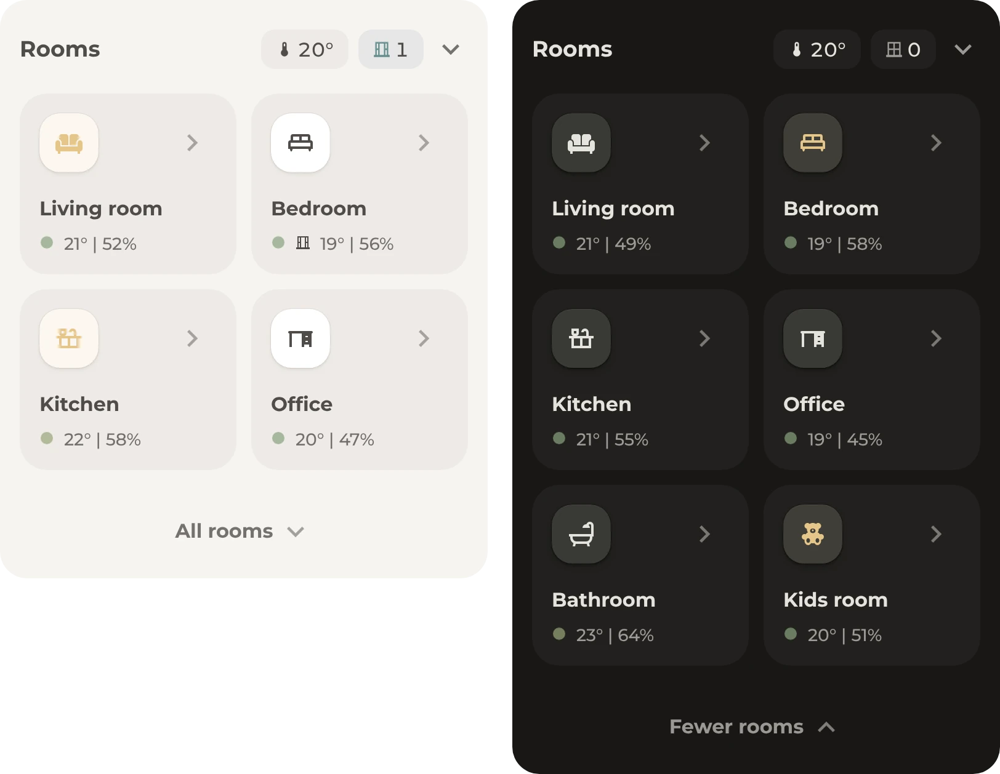

# Rooms

A card for each room with its climate and lights, and a tap opens the room's pop-up. The header adds the average temperature and how many windows are open.

## Requirements

- [Get started](../../README.md#get-started), with the modules Base and Header
- Optional: a **Toggle** helper named **All rooms**, for rooms that only show after a tap
- Optional: the [climate table](../climate-table/README.md), which opens under the header

## Setup

1. In [`header.yaml`](header.yaml), replace the example temperature sensors and window contacts with those of all rooms. The comments show where.
2. Add [`header.yaml`](header.yaml) to the dashboard, as described under [Get started](../../README.md#get-started).
3. Below it, add [`room.yaml`](room.yaml) once for each room, with that room's name, icon and entities. For a room without a window contact, delete the entry with `binary_sensor.living_room_window`.
4. In each room card, change `#popup_living_room` to the hash of the room's pop-up. Without a pop-up for the room, change the tap action, such as to **More info**.

Some rooms can stay hidden until a tap on **All rooms**, so the page stays short:

5. Open [Helpers](https://my.home-assistant.io/redirect/helpers/) under **Settings**, **Devices & services** and select **Create helper**, then **Toggle**. Name it **All rooms**, so its entity ID is `input_boolean.all_rooms`, and select **Create**.
6. Add [`all-rooms.yaml`](all-rooms.yaml) below the room cards.
7. In the editor of each room card that stays hidden, open **Visibility**, select **Add condition**, then **Entity state**, and choose **All rooms** and the state **On**. With `animate: true` under `origami_base`, the card fades in.

The chevron and a tap on the temperature or the windows open the [climate table](../climate-table/README.md). Without the climate table, delete the chevron and the tap actions of the temperature and the windows in [`header.yaml`](header.yaml).

## Entities

| Entity | Used for |
| --- | --- |
| `sensor.living_room_temperature`, `sensor.bedroom_temperature`, `sensor.office_temperature` | The average in the header. On a room card, the temperature and the dot, from blue when it's cold over green to red when it's hot. |
| `binary_sensor.living_room_window`, `binary_sensor.bedroom_window` | The open windows in the header, and the window on a room card |
| `sensor.living_room_humidity` | The humidity on the room card |
| `light.living_room` | The room's lights. The icon lights up while one of them is on, and a hold on the card opens them. |
| `input_boolean.all_rooms` | Shows the rooms that stay hidden until a tap on **All rooms** |
| `input_boolean.climate_table` | Opens the climate table. The climate table's setup creates this helper. |
