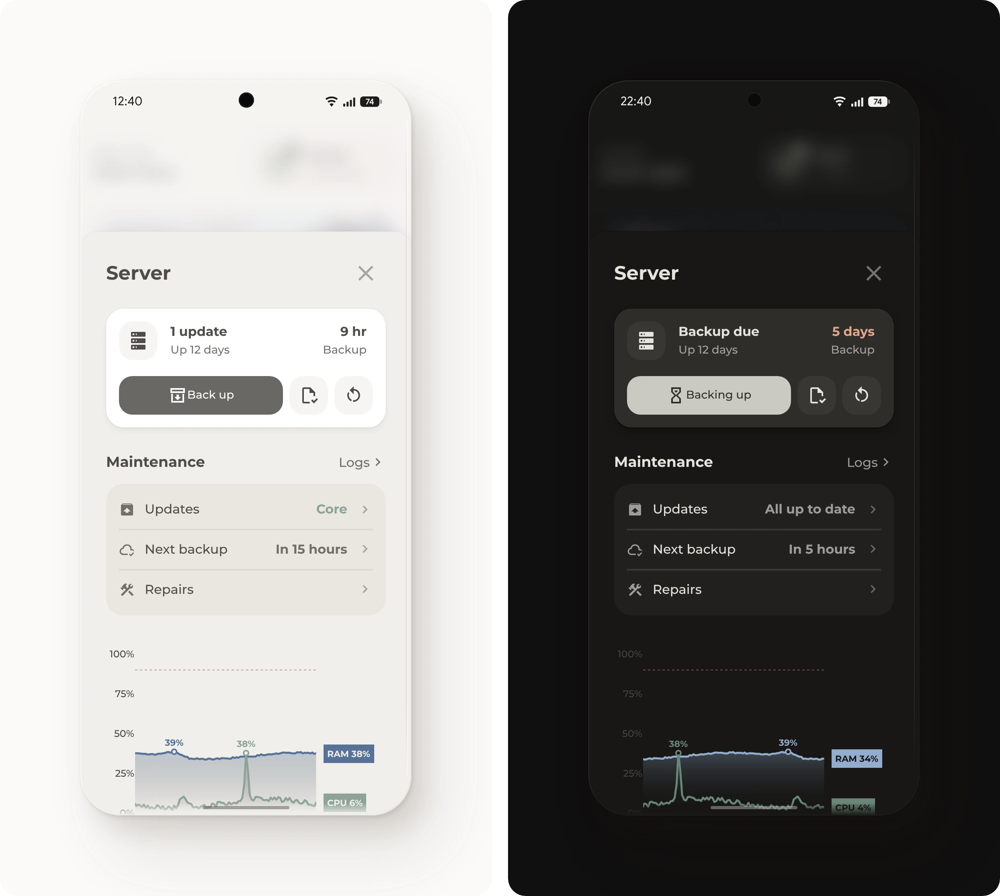

# Server pop-up

Shows the health, backups and updates of the Home Assistant server, with buttons to back up, check the configuration and restart. The top line names the most urgent problem, such as a full disk or a backup that is due.

## Requirements

- [Get started](../../README.md#get-started), with the modules Base, Popup, Button, Header and Tiles
- [System Monitor](https://www.home-assistant.io/integrations/systemmonitor/), an integration that comes with Home Assistant
- Automatic backups, set up under **Settings**, **System**, **Backups**
- Optional: [Plotly Graph Card](https://github.com/dbuezas/lovelace-plotly-graph-card) from HACS, for the graph

## Setup

1. [Add System Monitor](https://my.home-assistant.io/redirect/config_flow_start/?domain=systemmonitor) as an integration.
2. Turn on four of its sensors, which are off at first: **Processor use**, **Memory usage**, **Disk usage /** and **Uptime**. Open each one under the integration, select the gear icon, turn on **Enabled** and select **Update**.
3. Without Plotly Graph Card, delete the card under `# The load of the last 24 hours` in [`pop-up.yaml`](pop-up.yaml).
4. Add [`pop-up.yaml`](pop-up.yaml) to the dashboard, as described under [Get started](../../README.md#get-started).
5. Open the pop-up from a button whose tap action is **Navigate** to `#popup_server`, such as the server card in the [menu](../menu/README.md).

## Entities

| Entity | Used for |
| --- | --- |
| `sensor.system_monitor_processor_use`, `sensor.system_monitor_memory_usage`, `sensor.system_monitor_disk_usage` | The tiles and the top line, and processor and memory also in the graph. A tile turns red above 80%. |
| `sensor.system_monitor_uptime` | The uptime and the last restart |
| `sensor.backup_last_successful_automatic_backup` | The age of the last backup, orange after 3 days and red after 7 |
| `sensor.backup_next_scheduled_automatic_backup` | The next backup |
| `sensor.backup_backup_manager_state` | **Back up** turns into **Backing up** while a backup runs |
| `update.home_assistant_core_update`, `update.home_assistant_operating_system_update`, `update.home_assistant_supervisor_update` | The versions. While an update waits, its row shows the new version, and a tap opens the update. Only Home Assistant OS has the last two, so delete their rows on other installations. |
