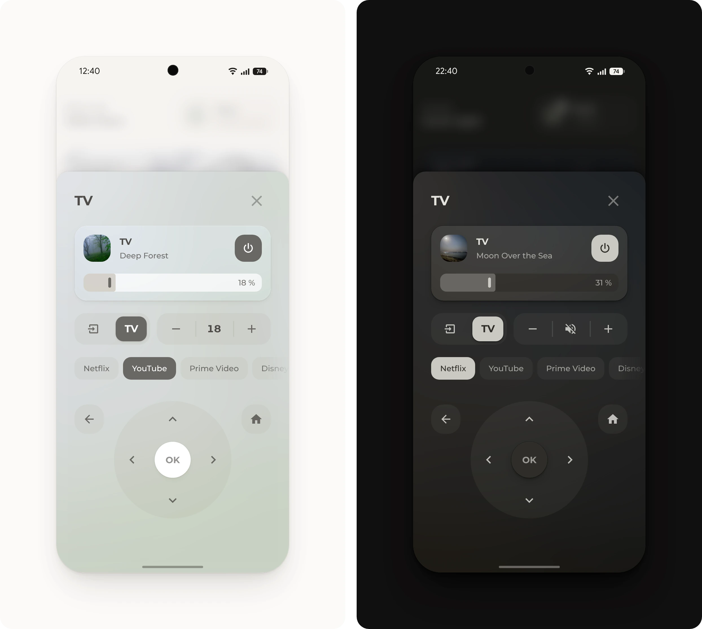

# TV pop-up

What's on, the TV's apps, a remote and the volume of the speaker that plays the TV's sound. While something is cast to the TV, a blurred picture of it shows behind the pop-up.

## Requirements

- [Get started](../../README.md#get-started), with the modules Base, Popup, Media and Button
- The TV in Home Assistant, as a media player that lists its apps as sources and a remote entity for the remote. The example uses [Android Debug Bridge](https://www.home-assistant.io/integrations/androidtv/) and [Android TV Remote](https://www.home-assistant.io/integrations/androidtv_remote/).
- Optional: [Google Cast](https://www.home-assistant.io/integrations/cast/), for what's cast and its picture
- Optional: the script [`volume.yaml`](volume.yaml), for the volume buttons

## Setup

1. In [`pop-up.yaml`](pop-up.yaml), change the entities to the home's own, as listed under [Entities](#entities). Change the app buttons to the TV's apps, with the names its `source` uses, and `Optical In` to the name of the speaker's TV input.
2. Optional: for the volume buttons, open [Scripts](https://my.home-assistant.io/redirect/scripts/) and select **Create script**, then **Create new script**. In the three-dot menu, select **Edit in YAML**, paste [`volume.yaml`](volume.yaml) and save it with the name **Volume**, so its entity ID is `script.volume`. The buttons change the volume by exactly 1 % on a tap, 5 % on a double tap and 10 % on a hold, and a tap on the number mutes, which Home Assistant's own volume actions can't. The slider alone is enough for most homes: then delete the group under `name: Volume` instead.
3. Add [`pop-up.yaml`](pop-up.yaml) to the dashboard, as described under [Get started](../../README.md#get-started).
4. Open the pop-up from a button whose tap action is **Navigate** to `#popup_tv`.

Without a separate speaker, point the slider and the volume buttons to the TV and delete the **TV** button, which switches the speaker to its TV input. With Android TV Remote alone, an app button starts its app with `media_player.play_media`, `media_content_type: app` and the app's ID as `media_content_id`.

> [!TIP]
> The row under the TV card is a [Button](../../bubble_card/README.md#button) row, so any button fits there, such as a sound mode or a sleep timer in place of the volume buttons.

> [!TIP]
> The remote and **Input** send Android TV Remote's key names, such as `DPAD_UP`. For another TV, each button takes its integration's names, such as `up`, `down` and `select` for Apple TV and Roku, or the action `webostv.button` for LG.

## Entities

| Entity | Used for |
| --- | --- |
| `media_player.living_room_tv` | The TV, its power and its apps. A button is filled while the TV runs its app. |
| `remote.living_room_tv` | The remote and **Input**, which opens the TV's inputs |
| `media_player.living_room_tv_cast` | What's cast to the TV and its picture, from Google Cast |
| `media_player.living_room` | The speaker that plays the TV's sound, with the slider, the volume buttons and **TV**, which switches it to its TV input |
| `script.volume` | The volume buttons |
