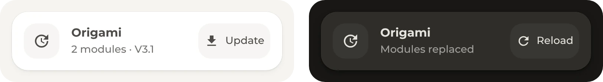

# Update card

For a dashboard with the Origami modules: their new versions in one tap, once the Marketplace has the new release. The [server pop-up](../server/README.md) has the same as a row in its list.

## Requirements

- [Get started](../../README.md#get-started), with the modules Base and Update
- [Bubble Card Tools](https://github.com/Clooos/Bubble-Card-Tools), which Get started sets up for the modules

## Setup

1. Add [`card.yaml`](card.yaml) to the dashboard, as described under [Get started](../../README.md#get-started).

## Entities

| Entity | Used for |
| --- | --- |
| Origami's update entity | The installed release, as the Marketplace lists it under [Updates](https://my.home-assistant.io/redirect/updates/). The card finds it on its own. Without it, the card takes the newest release on GitHub. |
