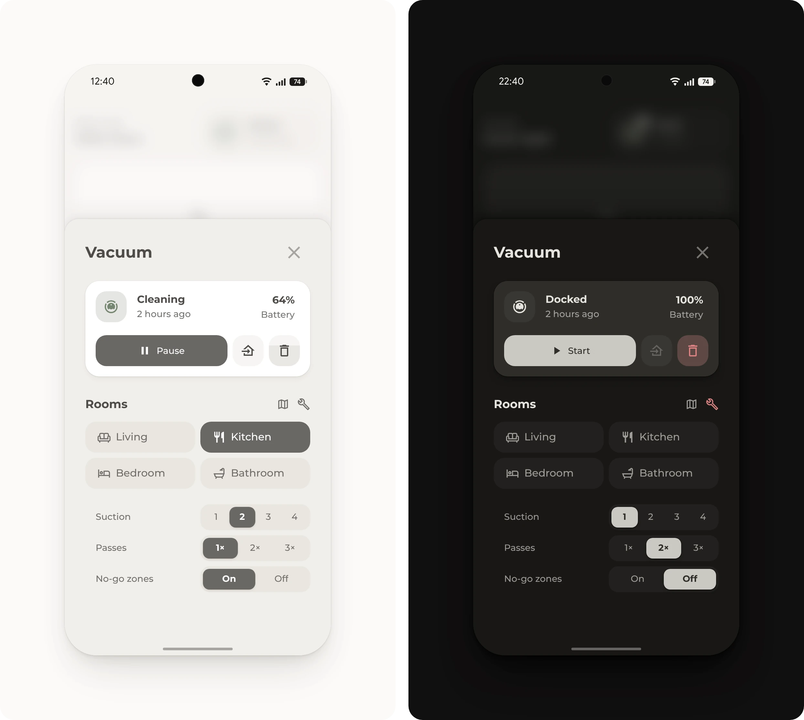

# Vacuum pop-up

Starts the vacuum or sends it to single rooms, and shows its battery and bin. The wrench lists its brushes, filter and sensors with the hours left, and turns red when a part is due.

## Requirements

- [Get started](../../README.md#get-started), with the modules Base, Popup, Header, Button and Tiles
- A vacuum that supports area cleaning, such as one from [Roborock](https://www.home-assistant.io/integrations/roborock/), for the room buttons. Area cleaning needs Home Assistant 2026.3 or later.
- A **Counter** helper and an automation, for the bin

## Setup

1. Open [Entities](https://my.home-assistant.io/redirect/entities/) and select the vacuum, then the gear icon. Select **Map vacuum segments to areas**, choose the area of each room and select **Save**.
2. Open [Helpers](https://my.home-assistant.io/redirect/helpers/) and select **Create helper**, then **Counter**. Name it **Vacuum bin**, so its entity ID is `counter.vacuum_bin`. Set **Maximum value** to the number of runs that fill the bin, such as 3, and select **Create**.
3. Open [Automations](https://my.home-assistant.io/redirect/automations/) and select **Create automation**, then **Create new automation**. In the three-dot menu, select **Edit in YAML**, paste [`bin.yaml`](bin.yaml), change `vacuum.robot` to the vacuum and select **Save**.
4. In [`pop-up.yaml`](pop-up.yaml), change the room buttons to the home's rooms. Each button's `cleaning_area_id` is the **Area ID** from the area's settings under [Areas](https://my.home-assistant.io/redirect/areas/).
5. Add [`pop-up.yaml`](pop-up.yaml) to the dashboard, as described under [Get started](../../README.md#get-started).
6. Open the pop-up from a button whose tap action is **Navigate** to `#popup_vacuum`, such as the vacuum tile in the [favorites](../favorites/README.md).

For a vacuum whose dock empties its bin, skip steps 2 and 3 and delete the sub-button under `# The bin` in [`pop-up.yaml`](pop-up.yaml). Without area cleaning, a room button can use the integration's own action for a room, if it has one, such as `xiaomi_miio.vacuum_clean_segment`.

## Entities

The sensors are examples from Roborock. A vacuum's device page lists its own sensors.

| Entity | Used for |
| --- | --- |
| `vacuum.robot` | The state as the name, the buttons and the rooms |
| `sensor.robot_battery` | The battery, which says **Charging** while the vacuum charges in its dock |
| `counter.vacuum_bin` | The bin, which fills with each run and turns red when full. A tap after emptying the bin sets it back to 0%. |
| `sensor.robot_current_room` | Optional. Lights up the room that the vacuum cleans, if the button has the room's name from the vacuum's app. |
| `sensor.robot_main_brush_time_left`, `sensor.robot_side_brush_time_left`, `sensor.robot_filter_time_left`, `sensor.robot_sensor_time_left` | The hours left for each part. Once a part is due, it says **Due** in red and the wrench turns red. |
