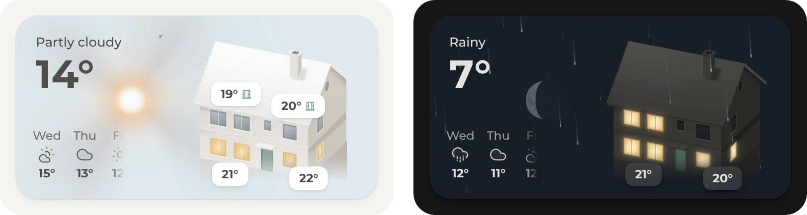
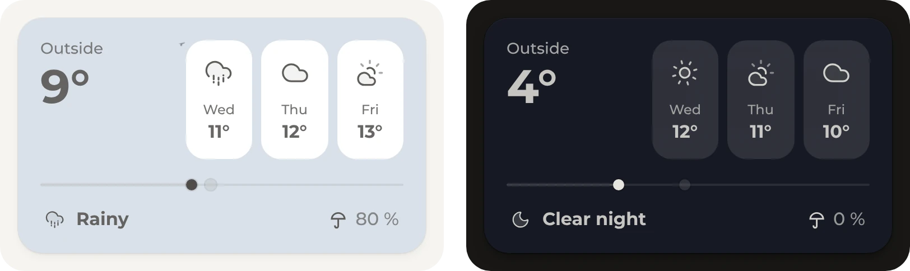

# Weather

Origami Weather is the part that took the longest by far, many hundreds of hours in 2026. It grew into a small builder for weather cards, so nearly anything is possible, from a realistic sky to a classic forecast or something quite exotic. The three cards here are only a start and some inspiration. The one on the maintainer's own dashboard changes all the time, just because a new look now and then keeps it fun.

<b>Calm on purpose</b>

 

All three cards keep the weather calm, and the house and the comparison card leave out most of its effects, such as the drifting clouds. That's only a matter of taste: after a year of looking at weather animations, the maintainer likes them toned down. Origami Weather can show much more, such as clouds, rain, snow and thunderstorms, stars with shooting stars, and birds, planes and balloons now and then. Each effect has an option of its own, and its [README](https://github.com/hazymorning/origami_weather#backgrounds) shows them all.

### Diorama

A little paper landscape for each kind of weather, the one layout made for Origami. The sun and the moon cross the sky and set behind the hills, and it's the card on the home view. [`diorama.yaml`](diorama.yaml)

<b>Another landscape, or a house</b>

 

The diorama is a set of pictures, one for each kind of weather in light and dark mode, named after the weather, such as `rainy.webp`. Any other place works the same way, such as a beach, a city or a house. The card loads the pictures from [`diorama`](diorama) in this repository, so a home needs no files of its own. Pictures of one's own go into the `www` folder of Home Assistant's configuration, and `weather_image_path` and `weather_image_path_dark` then point to `/local/` followed by their folder.

### House

A house whose rooms light up with the home's lights and show how warm they are, with the day's weather, low and high on a chip below the temperature. [`house.yaml`](house.yaml)

<b>The home's own house</b>

 

The house is a drawing, with one more picture for each room's light, and the card loads them from [`house`](house) in this repository. A drawing of the home's own house works the same way, and the [Origami Weather README](https://github.com/hazymorning/origami_weather#layouts) explains how to have one drawn. The pictures go into the `www` folder of Home Assistant's configuration, and the card loads them as `/local/` followed by their names.

### Comparison

Origami Weather's Comparison layout in calm colors, with the next days on tiles, the temperature on a bar and the chance of rain. Only the color changes with the weather. [`comparison.yaml`](comparison.yaml)

<b>With the sky behind it</b>

 

At the top of its file, the card turns off the sun, the moon and every effect, and gives each kind of weather a color. Without those lines, the same layout stands on Origami Weather's own sky, with everything that moves in it.

## Requirements

- [Get started](../../README.md#get-started), for the theme and the font
- [Origami Weather](https://github.com/hazymorning/origami_weather) from HACS
- A weather entity with a daily forecast, such as the one from [Met.no](https://www.home-assistant.io/integrations/met/), which comes with Home Assistant

## Setup

1. [Open Origami Weather in HACS](https://my.home-assistant.io/redirect/hacs_repository/?owner=hazymorning&repository=origami_weather&category=plugin). If HACS asks to add the repository, select **Add**. Then select **Download**, or update it if it's already there.
2. Pick a card: [`diorama.yaml`](diorama.yaml), [`house.yaml`](house.yaml) or [`comparison.yaml`](comparison.yaml). In its file, change each `weather.home` to the home's weather entity.
3. Add the card to the dashboard, as described under [Get started](../../README.md#get-started).

## Optional

- **Lit rooms.** For the house card in a home with lights. The house has a living room, a kitchen, a bedroom and an office, and their windows light up while their light is on. Change `light.living_room`, `light.kitchen`, `light.bedroom` and `light.office` to the home's lights, such as a light group for each room. Without a light, its room stays dark.
- **Room temperatures.** For the house card in a home with temperature sensors. The office and the kitchen always show their temperature, and the bathroom and the bedroom show theirs while a window is open. Change the sensors and the window contacts in the last block of [`house.yaml`](house.yaml) to the home's. A room without a sensor shows no temperature.

## Entities

| Entity | Used for |
| --- | --- |
| `weather.home` | The weather and the temperature on every card, the day's low and high on the house card, and the next days and the chance of rain on the comparison card |
| `sun.sun` | The next sunset or sunrise on the diorama card, and where the sun stands on the diorama and the house card. It comes with Home Assistant |
| `light.living_room`, `light.kitchen`, `light.bedroom`, `light.office` | Lit rooms: a room's windows light up while its light is on |
| `sensor.office_temperature`, `sensor.kitchen_temperature`, `sensor.bathroom_temperature`, `sensor.bedroom_temperature` | Room temperatures: the temperature of each room on the house |
| `binary_sensor.bathroom_window`, `binary_sensor.bedroom_window` | Room temperatures: the bathroom and the bedroom show their temperature while their window is open |
