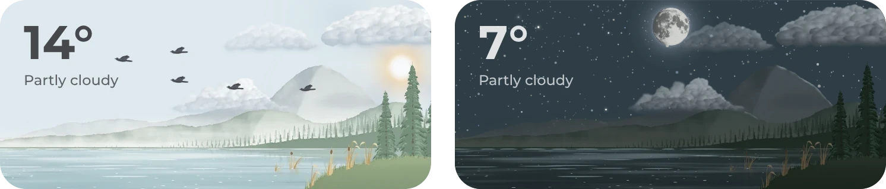

# Weather

Origami Weather is a little passion project which started as "Atmospheric Weather Card" on a previous GitHub account. It grew into a small builder for weather cards, so nearly anything is possible, from a realistic sky to a classic forecast or something very creative. The three cards here are only a start and some inspiration.

<b>More layouts</b>

 

The three cards are Origami Weather's own layouts. It has a few more, such as a classic forecast and a detailed panel, and its [README](https://github.com/hazymorning/origami_weather#layouts) shows them all.

### Diorama

A little paper landscape for each kind of weather, made for Origami, and the card on the home view. [`diorama.yaml`](diorama.yaml)

<b>Another landscape</b>

 

Any other place works the same way, with a picture for each kind of weather. Origami Weather's README [explains how](https://github.com/hazymorning/origami_weather#pictures).

### Sky

The sky as it is outside, and a tap shows the next days. [`sky.yaml`](sky.yaml)

### House

A little house in the weather outside, with the next sunset or sunrise, the wind and how warm the rooms are. [`house.yaml`](house.yaml)

<b>A drawing of the real home</b>

 

An AI can draw the real home in place of this house. Origami Weather's README [explains how](https://github.com/hazymorning/origami_weather#house).

## Requirements

- [Get started](../../README.md#get-started), for the theme and the font
- [Origami Weather](https://github.com/hazymorning/origami_weather) 1.7 or later, from the Marketplace
- A weather entity with a daily forecast, such as the one from [Met.no](https://www.home-assistant.io/integrations/met/), which comes with Home Assistant

## Setup

1. [Open Origami Weather in the Marketplace](https://my.home-assistant.io/redirect/marketplace_repository/?owner=hazymorning&repository=origami_weather&category=plugin) and select **Install**, or update it if it's already there.
2. Pick a card: [`diorama.yaml`](diorama.yaml), [`sky.yaml`](sky.yaml) or [`house.yaml`](house.yaml). In its file, change each `weather.home` to the home's weather entity.
3. Add the card to the dashboard, as described under [Get started](../../README.md#get-started).

## Optional

- **Room temperatures.** For the house card in a home with temperature sensors. Change `sensor.living_room_temperature`, `sensor.office_temperature` and `sensor.bathroom_temperature` to the home's sensors, and each room's `text`, such as `Living`, to its name. A room without a sensor isn't shown.

## Entities

| Entity | Used for |
| --- | --- |
| `weather.home` | The weather and the temperature on every card, the next days on the sky card, and the wind on the house card |
| `sun.sun` | The sun and the moon on the diorama and sky cards, and the next sunset or sunrise on the house card. It comes with Home Assistant |
| `sensor.living_room_temperature`, `sensor.office_temperature`, `sensor.bathroom_temperature` | Room temperatures: how warm each room is on the house card |
