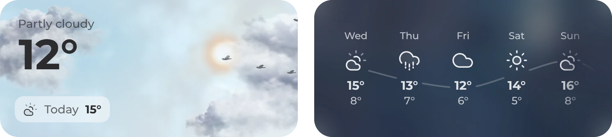
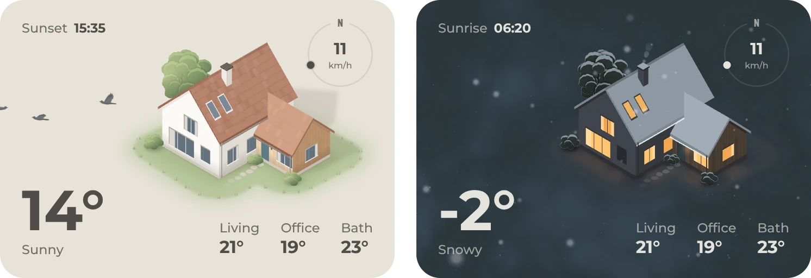

# Weather

Origami Weather is a little passion project which started as "Atmospheric Weather Card" on a previous GitHub account. It grew into a small builder for weather cards, so nearly anything is possible, from a realistic sky to a classic forecast or something very creative. The three cards here are only a start and some inspiration.

<b>More layouts</b>

 

Besides these three, Origami Weather has a classic forecast, a detailed panel and more. Its [README](https://github.com/hazymorning/origami_weather#layouts) shows them all.

### Diorama

A paper landscape that changes with the weather, and the card on the home view. It's kept calm and simple on purpose, so nothing distracts from the picture. Since it takes the best spot on the page mostly for looks, a tap shows the next days, borrowed from Origami Weather's Sky layout. [`diorama.yaml`](diorama.yaml)

<b>Another landscape</b>

 

A beach, a city or any other place works too, with one picture for every kind of weather. [Here's how](https://github.com/hazymorning/origami_weather#pictures).

<b>Something else on a tap</b>

 

A tap can show anything else instead of the next days. They're the container named `Days`, which shows while the card's switch `origami.forecast` is on, and any other container with the same `visibility` can take its place. Origami Weather's [reference](https://github.com/hazymorning/origami_weather/blob/main/REFERENCE.md#buttons) explains the switches.

### Sky

The sky as it looks outside, with the next days a tap away. [`sky.yaml`](sky.yaml)

### House

A small house in the current weather, with the wind, the next sunset or sunrise and how warm each room is. [`house.yaml`](house.yaml)

<b>The real home</b>

 

An AI can draw the actual home in its place, and Origami Weather has [a prompt for it](https://github.com/hazymorning/origami_weather#house).

## Requirements

- [Get started](../../README.md#get-started), for the theme and the font
- [Origami Weather](https://github.com/hazymorning/origami_weather) 1.7 or later, from the Marketplace
- A weather entity with a daily forecast, such as the one from [Met.no](https://www.home-assistant.io/integrations/met/), which comes with Home Assistant

## Setup

1. [Open Origami Weather in the Marketplace](https://my.home-assistant.io/redirect/marketplace_repository/?owner=hazymorning&repository=origami_weather&category=plugin) and select **Install**, or update it if it's already there.
2. Pick a card: [`diorama.yaml`](diorama.yaml), [`sky.yaml`](sky.yaml) or [`house.yaml`](house.yaml). In its file, change each `weather.home` to the home's weather entity.
3. Add the card to the dashboard, as described under [Get started](../../README.md#get-started).

## Optional

- **Room temperatures.** For the house in a home with temperature sensors. Change `sensor.living_room_temperature`, `sensor.office_temperature` and `sensor.bathroom_temperature` to the home's sensors, and each room's `text`, such as `Living`, to its name. Rooms without a sensor stay hidden.

## Entities

| Entity | Used for |
| --- | --- |
| `weather.home` | The weather on all three cards, with the forecast on the diorama and the sky, and the wind on the house |
| `sun.sun` | The sun and the moon on the diorama and the sky, and the next sunset or sunrise on the house. It comes with Home Assistant |
| `sensor.living_room_temperature`, `sensor.office_temperature`, `sensor.bathroom_temperature` | Room temperatures: one for each room of the house |
