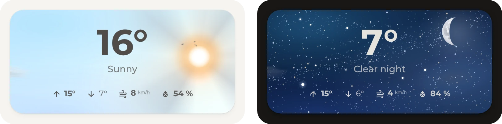

# Weather

Origami Weather is the part that took the longest by far, many hundreds of hours in 2026. It grew into a small builder for weather cards: a sky that moves with the weather, a picture for each kind of weather, a drawn house, values, chips, rings and forecasts, placed wherever they fit. So nearly any weather card is possible, and the three here are only a start:

- [`diorama.yaml`](diorama.yaml): a paper landscape for each kind of weather, with its own pictures for light and dark mode. The sun and the moon cross the sky and set behind the hills. It's the card on the home view.
- [`house.yaml`](house.yaml): a house whose rooms light up with the home's lights and show how warm they are, beside the forecast for the week.
- [`sky.yaml`](sky.yaml): the card's own sky, with clouds, rain and snow, birds and planes, and the stars at night, around the temperature, the day's high and low, the wind and the humidity.

The weather card has the best spot on the home view, and like every part, it's meant to be changed to taste. The one on the maintainer's own dashboard changes all the time, just because a new look now and then keeps it fun.

## Requirements

- [Get started](../../README.md#get-started), for the theme and the font
- [Origami Weather](https://github.com/hazymorning/origami_weather) from HACS
- A weather entity with a daily forecast, such as the one from [Met.no](https://www.home-assistant.io/integrations/met/), which comes with Home Assistant

## Setup

1. [Open Origami Weather in HACS](https://my.home-assistant.io/redirect/hacs_repository/?owner=hazymorning&repository=origami_weather&category=plugin). If HACS asks to add the repository, select **Add**. Then select **Download**, or update it if it's already there.
2. Pick a card: [`diorama.yaml`](diorama.yaml), [`house.yaml`](house.yaml) or [`sky.yaml`](sky.yaml). In its file, change each `weather.home` to the home's weather entity.
3. Add the card to the dashboard, as described under [Get started](../../README.md#get-started).

## Optional

- **Lit rooms.** For the house card in a home with lights. The house has a living room, a kitchen, a bedroom and an office, and their windows light up while their light is on. Change `light.living_room`, `light.kitchen`, `light.bedroom` and `light.office` to the home's lights, such as a light group for each room. Without a light, its room stays dark.
- **Room temperatures.** For the house card in a home with temperature sensors. The living room and the kitchen show their temperature at the foot of the house, and the bedroom and the office show theirs on the roof while a window is open. Change the sensors and the window contacts in the last block of [`house.yaml`](house.yaml) to the home's. A room without a sensor shows no temperature.

> [!TIP]
> The diorama's pictures and the house load from this folder of the repository, from [`diorama`](diorama) and [`house`](house), so a home needs no files of its own. Pictures of one's own, such as the real home drawn in the house's style as the [Origami Weather README](https://github.com/hazymorning/origami_weather#layouts) explains, go into the `www` folder of Home Assistant's configuration, and the card loads them as `/local/` followed by their names.

## Entities

| Entity | Used for |
| --- | --- |
| `weather.home` | The weather and the temperature on every card, the forecast for the week on the house card, and the day's high and low on the sky card |
| `sun.sun` | The next sunset or sunrise on the diorama card, and where the sun stands on every card. It comes with Home Assistant |
| `light.living_room`, `light.kitchen`, `light.bedroom`, `light.office` | Lit rooms: a room's windows light up while its light is on |
| `sensor.living_room_temperature`, `sensor.kitchen_temperature`, `sensor.bedroom_temperature`, `sensor.office_temperature` | Room temperatures: the temperature of each room on the house |
| `binary_sensor.bedroom_window`, `binary_sensor.office_window` | Room temperatures: the bedroom and the office show their temperature while their window is open |
